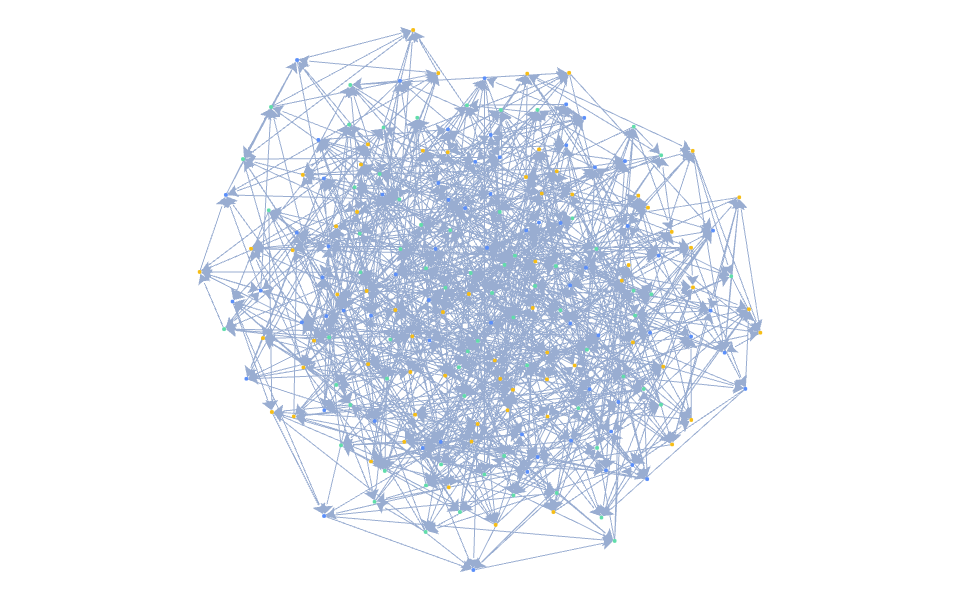

# G6Lite

English | [简体中文](./README.md)

[](https://www.npmjs.com/package/@antv/g6-lite)
[](https://github.com/antvis/G6Lite/actions/workflows/build.yml)
[](https://bundlephobia.com/package/@antv/g6-lite)
[](./LICENSE)

A lightweight, high-performance WebGL graph visualization engine.



## Core values

- **Batched WebGL rendering**: nodes and edges use a GPU rendering pipeline built for large relationship graphs.
- **Incremental interaction updates**: state, position, and data changes are scheduled by refresh level without unrelated full rebuilds.
- **AntV layouts**: integrates `@antv/layout`, including force, circular, grid, dagre, mindmap, and more.
- **Controlled extension boundary**: extend business capabilities through package-root APIs, functional mappings, and unified `register()`.

## Install

```bash
npm install @antv/g6-lite
```

## Minimal example

Prepare a container with an explicit size:

```html
<div id="graph" style="width: 800px; height: 500px"></div>
```

Then create and render a graph:

```ts
import { Graph } from '@antv/g6-lite';

const graph = new Graph({
  container: 'graph',
  data: {
    nodes: [{ id: 'a' }, { id: 'b' }, { id: 'c' }],
    edges: [
      { source: 'a', target: 'b' },
      { source: 'a', target: 'c' },
    ],
  },
  layout: { type: 'circular', radius: 140 },
  behaviors: ['zoom-canvas', 'drag-canvas', 'drag-node', 'hover-highlight'],
});

await graph.render();
```

Only package-root exports from `@antv/g6-lite` and `package.json#exports` are public API. Deep `src/` paths are not compatibility boundaries.

## Continue reading

- [Website](https://g6-gl.antv.vision/en)
- [Quick start](https://g6-gl.antv.vision/en/docs/getting-started/quick-start)
- [Core concepts](https://g6-gl.antv.vision/en/docs/concepts/overview)
- [Configuration](https://g6-gl.antv.vision/en/docs/guides/data)
- [API](https://g6-gl.antv.vision/en/docs/api)
- [Examples](https://g6-gl.antv.vision/en/docs/examples)
- [Technical metrics](https://g6-gl.antv.vision/en/docs/metrics/performance)
- [Compatibility](https://g6-gl.antv.vision/en/docs/compatibility/browser)

## Local development

```bash
npm install
npm run dev
```

Common verification commands:

```bash
npm run lint
npm run typecheck
npm test -- --coverage
npm run build
npm run size
node scripts/check-examples.mjs --profile release
npm run benchmark -- --suite all --mode quick
npm run site
```

## Contributing

Read the [contributing guide](./CONTRIBUTING.md) and [code of conduct](./CODE_OF_CONDUCT.md) before opening a pull request. Report bugs, feature requests, and usage questions through [GitHub Issues](https://github.com/antvis/G6Lite/issues).

## License

[MIT](./LICENSE) © AntV
