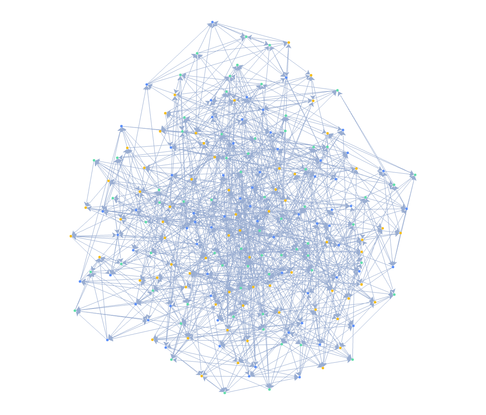

简体中文 | [English](./README.md)

<h1 align="center">G6Lite</h1>

<p align="center">
  <strong>轻量图可视化，为大规模关系数据而生</strong>
</p>

<p align="center">
  丰富的布局与交互，配合轻量高效的 WebGL 渲染，让大规模关系清晰呈现，让数据探索流畅自如。
</p>

<p align="center">
  <a href="https://www.npmjs.com/package/@antv/g6-lite"></a>
  <a href="https://github.com/antvis/G6Lite/actions/workflows/build.yml"></a>
  <a href="https://bundlephobia.com/package/@antv/g6-lite"></a>
  <a href="https://cdn.jsdelivr.net/npm/@antv/g6-lite@beta/dist/g6-lite.umd.min.js"></a>
  <a href="./LICENSE"></a>
</p>

<p align="center">
  <a href="https://g6lite.antv.vision">官网</a> ·
  <a href="https://g6lite.antv.vision/docs/getting-started/quick-start">快速开始</a> ·
  <a href="https://g6lite.antv.vision/docs/api">API</a> ·
  <a href="https://g6lite.antv.vision/docs/examples">示例</a>
</p>



## 为什么选择 G6Lite

- **轻量加载** — 核心与布局分离，算法按需加载，降低初始加载开销。
- **高效渲染** — WebGL 批量绘制与增量更新，支撑大规模关系图的展示与探索。
- **丰富布局与交互** — 提供多种图布局，支持缩放、平移、拖拽、选择与高亮。
- **灵活定制与扩展** — 按业务数据配置样式，按需扩展图形、布局与交互能力。
- **AI 协作开发** — 通过 G6Lite Skill，让 Agent 协助创建关系图、调整样式和配置交互。

## 安装

```bash
npm install @antv/g6-lite
```

## 快速开始

准备一个有明确宽高的容器：

```html
<div id="container" style="width: 800px; height: 500px"></div>
```

然后创建并渲染一个可交互的图：

```ts
import { Graph } from '@antv/g6-lite';

const graph = new Graph({
  container: '#container',
  data: {
    nodes: [
      { id: 'gateway', data: { role: 'core' } },
      { id: 'orders', data: { role: 'service' } },
      { id: 'inventory', data: { role: 'service' } },
    ],
    edges: [
      { source: 'gateway', target: 'orders' },
      { source: 'gateway', target: 'inventory' },
    ],
  },
  node: {
    type: 'circle',
    style: {
      size: 18,
      fill: (node) => (node.data?.role === 'core' ? '#1677ff' : '#36cfc9'),
    },
  },
  edge: { type: 'line', style: { lineWidth: 2 } },
  layout: { type: 'circular', radius: 140 },
  behaviors: ['zoom-canvas', 'drag-canvas', 'drag-node', 'hover-highlight'],
});

await graph.render();
```

公开 API 只以 `@antv/g6-lite` 包根导出和 `package.json#exports` 为准。`src/` 深层路径属于内部实现，可能随版本调整。

## CDN / UMD

无需构建工具，在浏览器中直接加载 UMD 包即可使用 `window.G6Lite`。产物包含运行时依赖、布局算法和内联的布局 Worker：

```html
<div id="container" style="width: 100%; height: 500px"></div>
<script src="https://cdn.jsdelivr.net/npm/@antv/g6-lite@beta/dist/g6-lite.umd.min.js"></script>
<script>
  const graph = new G6Lite.Graph({
    container: '#container',
    data: {
      nodes: [{ id: 'gateway' }, { id: 'orders' }, { id: 'inventory' }],
      edges: [
        { source: 'gateway', target: 'orders' },
        { source: 'gateway', target: 'inventory' },
      ],
    },
    layout: { type: 'circular', radius: 140 },
    behaviors: ['zoom-canvas', 'drag-canvas', 'drag-node'],
  });
  graph.render().catch(console.error);
</script>
```

- [jsDelivr](https://cdn.jsdelivr.net/npm/@antv/g6-lite@beta/dist/g6-lite.umd.min.js)
- [UNPKG](https://unpkg.com/@antv/g6-lite@beta/dist/g6-lite.umd.min.js)

生产环境请将 `beta` 替换为已发布的确切版本号。UMD 徽章展示完整 CDN 文件的下载体积；Bundlephobia 徽章展示该服务打包 npm 入口后测得的体积。

## 继续阅读

- [官网](https://g6lite.antv.vision)
- [快速开始](https://g6lite.antv.vision/docs/getting-started/quick-start)
- [核心概念](https://g6lite.antv.vision/docs/concepts/overview)
- [数据与配置](https://g6lite.antv.vision/docs/guides/data)
- [API 参考](https://g6lite.antv.vision/docs/api)
- [示例](https://g6lite.antv.vision/docs/examples)
- [性能指标](https://g6lite.antv.vision/docs/metrics/performance)
- [浏览器兼容性](https://g6lite.antv.vision/docs/compatibility/browser)

## 本地开发

```bash
npm install
npm run dev
```

使用 `npm run ci` 执行项目验证流水线，使用 `npm run site` 构建文档站点。

`npm run build` 会同时生成 ESM 产物和 `dist/g6-lite.umd.min.js`（含 source map）。使用 `npm run build:umd` 单独重新构建 UMD，使用 `npm run check:umd` 在 Chrome/Chromium 中验证产物和布局 Worker。

## 贡献

提交 Pull Request 前请阅读[贡献指南](./CONTRIBUTING.md)。Bug、功能建议和使用问题请通过 [GitHub Issues](https://github.com/antvis/G6Lite/issues) 提交。

## 许可证

[MIT](./LICENSE) © AntV
