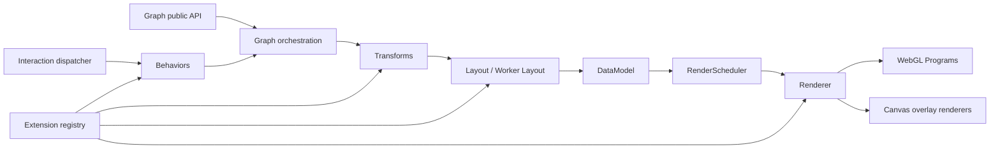

# P1：API、技术架构与扩展范式优化方案

> 状态：已实现并完成验收
> 对应 Dima：P1：API 与技术架构梳理（2026072100117612958）
> 范围：`src/` 核心库、公开类型与导出、扩展体系、布局接入、构建与导入规范
> 原则：本方案确认前不修改业务源码；确认后分阶段实施，每阶段独立验证并记录变更。

## 实施进度

- [x] Phase 0：架构、class 边界和 Graph API 初始基线
- [x] Phase 1：补齐一级目录内部出口
- [x] Phase 2：扩展系统统一
  - [x] 显式 `extensionFactory()` 与 beta 兼容分类
  - [x] Node / Label 接入通用 registry
  - [x] Behavior / Layout / Transform / Plugin 公共生命周期调用统一
  - [x] 扩展实例作用域形成基线并覆盖关键测试
  - [x] 注册 Behavior 与内置 Behavior 的优先级和挂载/销毁流程统一
  - [x] ExtensionContext 提供受控 data/state/viewport 能力
  - [x] ExtensionContext 查询返回只读快照，顶层业务 data 与状态数组不泄露内部引用
  - [x] 旧对象/class 实例提供尽力隔离，并明确只有 extensionFactory 保证有状态实例隔离
  - [x] 同类型 Transform 配置实例隔离并清理失效实例
  - [x] Node / Edge 样式、overlay 和边界回调统一错误隔离
  - [x] Layout 独立执行、Graph 生命周期和 AbortSignal 契约收口
- [x] Phase 3：扩展实现迁移
  - [x] 内置 Behavior / Edge / Label 使用 function 或无状态 descriptor
  - [x] `breathing-node` 实现改为 function + NodeExtension config
  - [x] Indented / Mindmap / Fishbone 改为无状态 layout executor
  - [x] BaseNode / BreathingNode 仅保留 beta deprecated 兼容壳
- [x] Phase 4：核心模块职责与 Graph API 整理
  - [x] DataModel / Scheduler / RendererData 从包根出口移除
  - [x] 新增包根运行时 API 边界测试
  - [x] Graph 查询结果改用只读 NodeModel / EdgeModel / ComboModel 公共类型
  - [x] `getNodes()` / `getEdges()` 改用只读 Model 集合并解除 Renderer 返回类型泄漏
  - [x] 发布声明剥离 `@internal` Graph 成员
  - [x] Graph API 完成 public / extension / internal 分类并冻结现有命名
  - [x] 按冻结契约补齐数据快照、`toData()` deprecated、相机快照和坐标专项测试
  - [x] 完成重复 `render()`、布局取消和 Combo 结构变更的生命周期验证
  - [x] 完成重入 generation、Combo 隐藏关系清理和 Label 异步销毁验证
- [x] Phase 5：构建与 import 后缀
  - [x] 正式采用 ESM-only，避免扩展 registry 双包实例
  - [x] TypeScript 切换 NodeNext 模块与解析校验
  - [x] 保留源码相对 import 的 `.js` 后缀
  - [x] 增加构建后 Node ESM 包入口检查
- [x] Phase 6：生态迁移与 API 冻结
  - [x] Playground 与官网示例移除 Graph internal API 依赖
  - [x] README、beta 迁移指南、release note 与扩展布局示例完成
  - [x] 公开运行时出口、声明边界和包消费检查接入构建 / CI / release

## 1. 背景与目标

该任务是测试、示例、README 和官网继续建设的前置工作。启动本任务时，仓库已经具备 Graph、DataModel、Layout、Scheduler、Renderer、WebGL Programs 等核心模块，但存在以下结构性问题：

1. `Graph` 同时承担生命周期编排、数据操作、布局、状态、相机、Combo、扩展挂载等职责，公开方法约 70 个，稳定面与内部逃生口尚未完成重新基线。
2. 扩展系统存在多套注册和实例化路径：通用 registry、Node 独立 registry、Label 独立注册、内置 Behavior 工厂表并存。
3. 扩展输入同时接受对象实例、factory 和 constructor，并通过 `try new / catch / call` 判断函数类型，生命周期与类型契约不够确定。
4. 用户扩展方式尚未统一：部分扩展接受 class constructor，部分接受对象实例或 factory，内置 Behavior 又使用独立函数工厂，用户需要理解多套范式。
5. 一级目录出口不完整：`interaction`、`renderer`、`routing`、`transforms` 缺少 `index.ts`；根出口直接穿透多个内部文件。
6. 生产源码的相对 import 使用显式 `.js` 后缀。该写法服务于 TypeScript 编译后的 Node ESM，并由 NodeNext 解析规则校验，不能机械删除。

本任务目标：

- 固化并文档化当前架构、渲染链路、模块职责和数据流。
- 对 Graph 一级 API 做逐项分类，形成正式版前唯一一次 API 重新基线。
- 建立统一、函数优先的扩展范式和生命周期契约。
- 核心有状态模块继续使用 class；用户扩展和无状态计算统一采用 function/factory/config 形态。
- 建立清晰的目录出口和 public/internal/extension 三层 API 边界。
- 固化 ESM-only 构建与 import 后缀契约。

## 2. 非目标

- 本任务不新增业务功能或视觉效果。
- 本任务不重写 @antv/layout 第三方实现。
- 本任务不在第一阶段调整 README、官网和全部示例；它们在 API 基线确认后统一迁移。
- 不承诺兼容所有未声明的内部深层路径导入。
- 不采用一次性全仓重写；每一步必须可测试、可回滚、可对照性能。

## 3. 当前架构与渲染链路

### 3.1 主链路



### 3.2 初始职责基线

| 模块 | 初始职责 | 初始问题 |
| --- | --- | --- |
| `Graph` | 容器、生命周期、布局、数据、状态、相机、扩展、事件统一入口 | 体量过大，公开/内部方法混杂 |
| `DataModel` | 节点、边、Combo 的内存模型与增量变更 | 作为 class 和内部逃生口直接导出 |
| `Layout` | 内置布局、Worker、自定义布局统一执行 | 内置 class/第三方 class/扩展对象协议并存 |
| `RenderScheduler` | 合并刷新级别并调度绘制 | 与 Graph/Renderer 的边界需显式化 |
| `Renderer` | WebGL 资源、绘制、相机、拾取 | 内部职责多，依赖多个 class 子模块 |
| `WebGL Programs` | shader/program/buffer 生命周期和具体图元绘制 | 资源生命周期和内部继承边界需要明确，但不要求函数化 |
| `Behaviors` | 内置交互和自定义行为 | 内置 factory 与扩展生命周期不是同一范式 |
| `Extensions` | 注册 node/edge/label/layout/behavior/transform/plugin | registry 分裂，输入类型与实例化规则不确定 |

## 4. 目标架构

### 4.1 分层

1. **Public API**：用户稳定使用的 `Graph` 能力、配置、数据与查询类型。
2. **Extension API**：注册函数、扩展 factory、上下文、生命周期、图元素/标签/布局契约。
3. **Internal API**：数据模型、调度器、Renderer、Program、worker 协议等实现细节，不从根入口导出。

### 4.2 class 与 function 的边界

引擎内部需要长期持有状态、缓存、GPU/DOM 资源或稳定实例 API 的模块继续使用 class。`Graph` 保持与 G6 一致的公开构造方式：

```ts
export class Graph {
  constructor(options: GraphOptions) {}
  render(): Promise<void> {}
  destroy(): void {}
}
```

以下模块原则上保留 class：

- `Graph`、`EventEmitter`
- `DataModel`、`RenderScheduler`
- `Renderer`、`PickingManager`、`LabelLayerRenderer`、`ComboRenderer`、`LabelGrid`
- WebGL `Program` 及具体 Node/Edge Program
- 其他需要持续状态、缓存、取消能力或显式 `destroy()` 的内部模块

用户扩展和无状态逻辑采用 function/factory/config。扩展不再要求用户继承内部基类，也不再猜测传入函数是 constructor 还是普通函数：

```ts
export type ExtensionFactory<TExtension> = () => TExtension;

register(
  'behavior',
  'custom-behavior',
  extensionFactory(() => ({
    init(context, options) {},
    update(next) {},
    getEvents() {
      return {};
    },
    destroy() {},
  })),
);
```

### 4.3 Graph 公开入口策略

`new Graph(options)` 保持为唯一推荐、长期稳定的公开初始化方式：

```ts
import { Graph } from '@antv/g6-gl';

const graph = new Graph(options);
```

不新增公开 `createGraph()`，也不支持 `Graph(options)` 无 `new` 调用。`Graph` 底层继续使用真正的 class 实现，不设计函数式 facade 或 runtime 转发层。

## 5. Graph API Phase 4 最终基线

本节是 Phase 4 的最终 Graph API 分类，取代
`graph-api-review.md` 中尚未确认的候选别名和重命名建议。若历史候选文档与本节冲突，
以本节为准。

### 5.1 命名冻结原则

1. `new Graph(options)` 是永久保留的唯一公开创建方式，不新增 `createGraph()`，也不支持无
   `new` 调用。
2. 冻结当前 Graph 方法名，不为了表面对齐 G6 新增同义入口。继续使用
   `addNode()` / `addEdge()` / `createCombo()`、`updateOptions()`、`cancelLayout()`、
   `focusItem()`；不新增 `addNodeData()` / `addEdgeData()` / `addComboData()`、
   `setOptions()` / `getOptions()`、`stopLayout()`、`focusElement()` 等 alias。
3. 不新增 `getCanvasElement()`、`collapseElement()` 等仅转发到现有实现的 API。确有新语义或
   新消费需求时，必须重新提交独立方案，而不是在本次冻结后继续扩张 Graph 表面积。
4. `getData()` 是数据快照的唯一推荐入口。`toData()` 作为已有兼容入口保留并标记
   `@deprecated`，后续文档、示例和新代码不再使用它。
5. Phase 6 只做生态迁移、类型验证和冻结，不再进行第二轮 Graph 结构性重命名。

### 5.2 Public Graph API 完整分组

以下分组覆盖当前发布声明中的全部 Graph 一级成员。除 `toData()` 外，方法名均按当前名称
进入本轮基线。

| 分组 | Public 成员 | 冻结语义 |
| --- | --- | --- |
| 创建与生命周期 | `new Graph(options)`、`destroyed`、`isDestroyed()`、`render()`、`destroy()` | `Graph` 继续为真正的 class；`destroy()` 幂等；重复 `render()` 必须先释放上一轮 runtime 资源，不能重复挂载监听器、Observer、Scheduler 或 Canvas overlay。 |
| 相机与视口 | `getCamera()`、`setCamera()`、`resetCamera()`、`fitView()`、`fitCenter()`、`setSize()`、`getZoom()`、`zoomTo()`、`zoomBy()`、`screenToGraph()`、`graphToScreen()`、`focusItem()` | 相机只能通过 Graph 方法修改；坐标契约见 5.5。`focusItem()` 名称保留，不新增 `focusElement()`。 |
| 全量数据与集合查询 | `getData()`、`toData()`、`setData()`、`getNodes()`、`getEdges()` | `getData()` 返回当前业务图数据快照；`toData()` 是 deprecated alias。`getNodes()` / `getEdges()` 返回 Graph 持有的只读 Model 视图，不承诺不可变快照或稳定对象身份。 |
| Node 数据变更 | `addNode()`、`addNodes()`、`removeNode()`、`removeNodes()`、`updateNodePosition()`、`updateNodePositions()`、`updateNodeData()` | 保留单个与批量入口；位置和业务 `data` 是两类更新语义，不合并为模糊的通用 update。增量变更在首次 `render()` 后使用。 |
| Edge 数据变更 | `addEdge()`、`addEdges()`、`removeEdge()`、`removeEdges()`、`updateEdgeData()` | 保留当前名称和单个/批量签名；不增加 `*Data` 同义方法。 |
| 元素与拓扑查询 | `getNodeData()`、`getEdgeData()`、`getComboData()`、`getElementData()`、`getNodePosition()`、`getElementPosition()`、`hasNode()`、`hasEdge()`、`hasElement()`、`getNodeCount()`、`getEdgeCount()`、`getNeighborNodes()`、`getAdjacentEdges()` | 单元素查询返回只读公共 Model；拓扑查询继续返回当前 ID / 轻量边结构，不泄露 DataModel 或 Renderer 记录。 |
| 状态与可见性 | `setItemState()`、`clearItemStates()`、`batchSetState()`、`setElementStates()`、`getItemStates()`、`hideItem()`、`showItem()`、`findNodesByState()`、`findEdgesByState()`、`findCombosByState()`、`setComboState()`、`clearComboStates()`、`getComboStates()` | 名称全部保留，不机械统一为 element alias；不同写法分别表示“增删单状态”和“替换完整状态集合”，具体语义见 5.4。 |
| 配置与刷新 | `updateOptions()`、`refresh()` | `updateOptions()` 继续只更新当前声明允许的视觉配置；不以宽泛名称为由自动扩展到所有 `GraphOptions`。`refresh()` 是用户主动要求完整重处理的高层入口。 |
| 布局 | `setLayout()`、`layout()`、`cancelLayout()` | 保留现有三段式配置、执行和取消语义，不新增 `stopLayout()` alias。布局扩展的取消能力通过 `AbortSignal` 实现。 |
| 事件 | `on()`、`off()`、`once()` | 用户只通过 Graph 事件方法订阅；不访问内部 EventEmitter。现有事件名保持兼容，不再为同一事件新增第三套 alias。 |
| Combo 结构与折叠 | `collapseCombo()`、`expandCombo()`、`toggleCombo()`、`getComboChildren()`、`getNodeCombo()`、`addToCombo()`、`removeFromCombo()`、`createCombo()`、`removeCombo()` | Combo 专用能力保留，暂不抽象为通用 element API。所有公开变更方法必须自行安排正确刷新，用户不应额外调用 internal `scheduleRender()`。 |

### 5.3 数据查询类型契约

- `getData()` 返回可独立使用的 `GraphData` 结构快照，包括当前坐标、状态、Combo 归属和运行时
  Combo；数组、元素记录、状态数组和顶层 `data` 对象均重新创建，修改这些返回结构不得反向修改
  Graph。任意深度业务对象不承诺递归克隆。
- `getNodeData()` / `getEdgeData()` / `getComboData()` / `getElementData()` 以及
  `getNodes()` / `getEdges()` 返回 `NodeModel` / `EdgeModel` / `ComboModel` 只读视图。
- Model 是高性能 live view，不是不可变快照；它由 Graph 持有，不承诺对象 identity 长期稳定。
- 用户不能直接改写 Model 的坐标、data、states 或 Combo 集合，所有变更必须通过 Graph 数据、
  位置、状态和 Combo API 完成。
- `InternalNode`、`InternalEdge`、`InternalCombo`、`LayoutNode` 和 Renderer 数组类型不进入
  公共返回签名。

### 5.4 状态 API 语义

状态 API 保留现有名称，是因为两类核心操作不是同一语义：

1. `setItemState(id, state, value)`：只增删一个状态，其他状态保持不变；适用于 node、edge、
   combo。`hideItem()` / `showItem()` 是对 `hidden` 状态的便利封装。
2. `batchSetState(items)`：在一个批次内执行多次单状态增删，语义与逐项
   `setItemState()` 相同，但只安排一次刷新。
3. `setElementStates(id, states)`：用传入数组完整替换该元素的业务状态集合；map 重载对多个
   元素执行同样的完整替换。`default` 表示没有激活的业务状态，不作为 active state 保存。
4. `clearItemStates(id)`：清除元素全部业务状态。若元素因为折叠 Combo 处于结构性隐藏，清除
   业务状态不能越过该结构约束将其错误显示。
5. `getItemStates(id)`：返回当前状态数组副本，修改返回数组不会修改 Graph。
6. `setComboState()` / `clearComboStates()` / `getComboStates()`：保留为 Combo 便利入口，
   分别对应单状态增删、全部清空和数组查询；不再新增另一套通用状态 alias。
7. `findNodesByState()` / `findEdgesByState()` / `findCombosByState()`：按元素类型返回匹配的
   ID，不返回内部 Model 记录。

### 5.5 相机与坐标系契约

- Graph 坐标：布局、节点位置和路由使用的逻辑坐标，不包含 Canvas offset、页面滚动和 DPR。
- Client / screen 坐标：浏览器 viewport 中的 CSS pixel，与
  `MouseEvent.clientX/clientY` 一致。
- Canvas 局部坐标：相对主 Canvas 左上角的 CSS pixel，只用于事件 payload 和内部渲染；
  Canvas backing-store pixel 由局部坐标乘实际缩放比 / DPR 得到，不作为 Graph 一级 API。
- `screenToGraph(screenX, screenY)` 接受 client 坐标并返回 Graph 坐标。
- `graphToScreen(graphX, graphY)` 接受 Graph 坐标并返回 client 坐标。相同相机和 viewport 下，
  两者应在浮点误差内互为逆运算。
- `ZoomOptions.center` 使用 client 坐标；`FitViewOptions.padding` 使用 viewport CSS pixel。
- `getCamera()` 返回当前 `{ x, y, zoom }` 的只读快照，而不是 Renderer 内部可变对象。
  修改返回值不得改变 Graph；相机更新统一通过 `setCamera()`、zoom、fit、focus 方法完成。

### 5.6 Extension API 边界

扩展通过 `register()`、`extensionFactory()`、各 category 契约和 `ExtensionContext` 接入，不把
Graph 内部协作方法重新定义为扩展 API：

- `context.data` 提供只读查询和受控 node / edge data 更新。
- `context.state` 使用完整状态集合语义执行 set / setAll，并提供 get / clear。
- `context.viewport` 提供坐标转换和 zoom 查询。
- `context.requestRender()` 是扩展请求重绘的唯一入口；扩展不调用
  `graph.scheduleRender()`。
- Layout 扩展通过执行上下文取得 `AbortSignal`，不得持有或操作全局 Worker。
- `context.graph` 及旧的平铺坐标方法只属于 beta deprecated 兼容层，不进入长期扩展契约。

### 5.7 Internal API 边界

以下能力只服务引擎协作，不属于用户或扩展稳定面，并必须从包根、TypeDoc 和发布声明中剥离：

- Graph 内部成员：`eventEmitter`、`getLayoutNodes()`、`getCanvas()`、`getNodeIndex()`、
  `pickAt()`、`pickComboAt()`、`setHighlight()`、`clearHighlight()`、
  `updateData(RendererData)`、`scheduleRender()` 及其 `PickResult` / Renderer 相关类型。
- 核心实现：`DataModel`、`RenderScheduler`、`RefreshLevel`、`Renderer`、
  `RendererData`、Picking、Label / Combo renderer、WebGL Programs、worker 协议和 mutable
  `Internal*` records。
- internal 成员即使因引擎布线暂时存在于 JavaScript runtime，也没有兼容承诺；测试、
  playground、官网和业务示例不能把它们作为公共用法展示。

公开替代关系固定如下：布局后节点查询使用 `getNodes()`；事件订阅使用 `on/off/once`；状态
高亮使用状态 API；扩展刷新使用 `context.requestRender()`；Combo 等公开变更方法自行触发刷新。

## 6. 统一扩展范式

### 6.1 注册入口

只保留一个公开注册入口；有状态扩展通过 `extensionFactory()` 显式声明工厂：

```ts
register(category, name, extensionFactory(() => extension));
```

内部可以按 category 建独立 registry，但 Node、Edge、Label、Decoration、Layout、Behavior、Transform、Plugin 必须共享：

- 名称校验
- 重复注册策略
- factory 实例化
- 错误隔离
- 生命周期调用
- 销毁与缓存策略

### 6.2 生命周期

统一最小生命周期：

```ts
interface ExtensionLifecycle<TOptions> {
  init?(context: ExtensionContext, options: TOptions): void;
  update?(options: Partial<TOptions>): void;
  destroy?(): void;
}
```

不同类别在此基础上增加能力：

- Behavior：事件映射或命令处理
- Node / Edge：样式解析、边界计算、可选 overlay/program 描述
- Label / Decoration：measure、draw
- Layout：execute，并必须支持 `AbortSignal`
- Transform：beforeLayout / beforeRender 等明确阶段
- Plugin：在公共生命周期基础上增加 `mount(container)` 容器挂载能力

### 6.3 ExtensionContext

上下文只暴露稳定能力，不直接暴露 Graph 全对象：

- `requestRender()`
- 数据只读查询与受控更新
- `screenToGraph` / `graphToScreen`
- zoom 只读查询
- `isDestroyed()`

Behavior 通过 `getEvents()` 声明事件映射；Layout 的 `AbortSignal` 由 `execute()` 的执行上下文
提供，不把通用 EventEmitter 或 Worker 暴露给扩展。

当前 `context.graph: Graph` 会绕过扩展边界，应在兼容期后移除。

### 6.4 类型契约

- 注册时通过 category 推导 extension 返回类型；各生命周期方法继续约束自身 options。
- 禁止 `any` 贯穿扩展配置；内置 Behavior 也使用同一份类型映射。
- 推荐入口禁止依赖函数抛错来猜测 constructor/factory；`extensionFactory()` 提供显式分类。
- beta 兼容层暂时保留 instance / factory / constructor 联合输入和 constructor 识别，长期扩展契约不再要求 constructor。
- 明确 singleton 与 per-graph instance：默认每个 Graph/每次挂载创建独立实例，只有无状态 renderer descriptor 可安全共享。

## 7. class 与 function 的实施范围

### 7.1 保留 class

满足以下任一条件的模块保留 class：

- 对外提供稳定实例 API，例如 `new Graph(options)`。
- 长期维护可变状态、索引、缓存或任务队列。
- 持有 WebGL、Canvas、DOM、Worker 等需要显式释放的资源。
- 具有清晰且合理的继承关系，例如 WebGL Program 基类与具体实现。
- 需要取消、销毁、重复更新等完整生命周期。

因此不实施 `Graph`、`DataModel`、`Renderer`、`RenderScheduler`、WebGL Programs 等核心模块的机械函数化。

### 7.2 改为 function/factory/config

- 自定义 Behavior
- Node / Edge 样式、边界和绘制扩展
- Label / Decoration 的 measure/draw 扩展
- 自定义 Layout 接入
- Transform
- 无状态配置归一化、样式解析、坐标计算、路由计算和数据转换

### 7.3 自研布局的判断

`IndentedLayout`、`MindmapLayout`、`FishboneLayout` 不预设必须改成 function：

- 如果只是单次输入输出计算，改为 layout executor function。
- 如果需要迭代状态、缓存、取消或增量执行，保留 class。

### 7.4 扩展兼容策略

- 新推荐范式为 function/factory/config；有状态扩展使用 `extensionFactory()`。
- 现有 constructor 扩展在 beta 期提供兼容适配与迁移提示，但不再使用 `try new / catch / call` 探测。
- 内部 class 不作为用户扩展必须继承的公开基类。
- 兼容期结束后可删除 constructor 输入与 `context.graph` 等 deprecated 兼容字段。

## 8. 目录出口

每个一级目录建立 `index.ts`，但出口分两类：

- public/extension 目录：允许被根 `src/index.ts` 重新导出。
- internal 目录：`index.ts` 仅供源码内部聚合，不自动进入包根出口。

已补齐：

- `src/interaction/index.ts`
- `src/renderer/index.ts`
- `src/routing/index.ts`
- `src/transforms/index.ts`

根出口禁止继续直接导出 `DataModel`、`RenderScheduler`、`RendererData` 等内部实现；如确需高级入口，使用显式子路径 `@antv/g6-gl/advanced`，并单独声明稳定性。

## 9. `.js` import 后缀处理

最终决策为 TypeScript 直接输出单一 ESM 产物：

1. 使用 `module: NodeNext` 与 `moduleResolution: NodeNext` 校验原生 ESM 解析。
2. 源码相对 import 保留显式 `.js` 后缀，使生成的 JS 与声明文件能直接解析同目录产物。
3. 构建前清理 `dist`，防止已删除或改名模块的陈旧文件进入发布包。
4. 构建后验证 Node ESM 包入口、公开运行时出口和声明边界。

不发布 CJS 物理副本。除 Worker 的 `import.meta.url` 需要额外构建设计外，ESM/CJS 双份模块还会复制扩展 registry 与 descriptor cache，产生扩展注册隔离。CJS 仅在出现明确消费需求后作为独立方案处理。

## 10. 实施阶段与交付物

### Phase 0：基线盘点

- 架构图和渲染时序图
- 当前根导出清单
- Graph API 完整对照表
- class 清单、继承关系和实例生命周期清单
- `.js` import 与消费环境基线

### Phase 1：出口与边界

- 补齐一级目录 `index.ts`
- 建立 public/extension/internal 分类
- 增加 API 快照测试，阻止意外导出漂移

### Phase 2：扩展系统统一

- 统一 registry 和 factory
- 统一生命周期与 ExtensionContext
- 内置 Behavior、Node、Edge、Label、Layout 接入同一范式
- 提供旧 constructor 扩展的 beta 迁移适配

### Phase 3：扩展实现迁移

- 将内置 Behavior、Node、Edge、Label、Layout 接入统一的 function/factory/config 范式
- 按状态与资源需求判断自研布局是否函数化
- 保持 Graph 对外行为不变

### Phase 4：核心模块职责整理

- 保留 `Graph`、`DataModel`、`Renderer`、Scheduler 和 Program class
- 按第 5 章最终基线冻结 Graph 现有方法名，不新增 G6 同义 alias
- 固化数据快照 / live Model、状态增删 / 完整替换、坐标和相机快照语义
- 将 Renderer、拾取、Canvas、调度和 mutable records 限定为 internal
- 仅在职责确实混杂时拆分 controller，不以消除 class 为目标
- 验证 GPU 资源释放、渲染结果和性能

### Phase 5：构建与 import 后缀

- 采用单一 ESM 产物，避免 ESM/CJS 双份模块级 registry 导致扩展实例隔离。
- 使用 `module: NodeNext` / `moduleResolution: NodeNext` 校验 Node ESM 解析规则。
- 源码相对 import 保留显式 `.js` 后缀，确保 `tsc` 产物可被 Node 原生 ESM 加载。
- CJS 仅在出现明确消费方后单独设计，届时必须同时解决 Worker URL 和 registry 单例桥接。
- 验证类型声明、Node ESM 包入口、Playground 和官网构建。

### Phase 6：生态迁移与冻结

- 更新测试、playground、README、官网
- 输出迁移指南和 beta release note
- 生成新的公开 API 基线并冻结

## 11. 测试与验收

每个阶段至少执行：

- `npm run lint`
- `npm run typecheck`
- `npm run test`
- `npm run build`
- `npm run size`

关键专项验证：

- Graph 生命周期、重复 render、destroy 后调用、并发布局取消
- 数据增删改、批量更新、状态和 Combo 行为
- 相机、坐标转换、fit/zoom
- 所有内置 Behavior 与自定义 Behavior
- 自定义 Node / Edge / Label / Layout
- Renderer draw call、GPU 资源销毁、拾取和高 DPI
- 大图布局与首屏性能基线不退化
- Node ESM import、TypeScript NodeNext、Vite build
- 根导出符号快照和 `.d.ts` 可用性

## 12. 风险与控制

| 风险 | 控制措施 |
| --- | --- |
| 扩展范式调整导致业务扩展失效 | beta 期保留 constructor 适配并提供迁移示例 |
| 为追求函数化破坏合理的状态封装 | 以状态、资源和生命周期为判断标准，不机械消除 class |
| 扩展实例被跨 Graph 共享 | 有状态扩展使用 `extensionFactory()` 保证独立实例；beta 对象/class 输入仅提供尽力兼容克隆 |
| 核心 class 职责继续膨胀 | 通过 controller 边界和 internal API 整理控制复杂度 |
| 删除 `.js` 后 Node ESM 失效 | 使用 NodeNext 固化显式后缀并增加构建后入口检查 |
| ESM/CJS 双份 registry 导致扩展隔离 | 当前仅发布单一 ESM 实现 |
| 当前大量未提交改动与本任务交叉 | 实施时严格按阶段限定文件，不覆盖现有用户改动 |

## 13. 已确认决策

1. `new Graph(options)` 是唯一推荐且长期保留的公开创建入口；不新增公开 `createGraph()`。
2. 核心有状态模块保留 class，不进行全量 class → function 改造。
3. 用户扩展和无状态逻辑采用 function/factory/config；constructor 仅提供限时兼容适配。
4. `ExtensionContext` 不再长期暴露完整 `graph` 对象。
5. `DataModel`、`RenderScheduler`、`RendererData` 从根公开入口移除。
6. 发布形态为 ESM-only；源码 `.js` 后缀属于正式解析契约并继续保留。
7. Graph 现有方法名进入 Phase 4 基线；不新增 `*Data`、`setOptions/getOptions`、
   `stopLayout`、`focusElement` 等 G6 同义 alias。
8. `getData()` 是推荐数据快照入口；`toData()` 仅作为 deprecated 兼容入口保留。
9. 状态 API 同时保留单状态增删、批量单状态操作和完整集合替换，因为三者语义不同；
   Combo 状态方法保留为便利入口。
10. `screenToGraph()` / `graphToScreen()` 使用 client viewport CSS pixel 与 Graph 坐标互转；
    `getCamera()` 返回只读快照，相机只能通过 Graph 公开方法更新。

## 14. 完成定义

- 架构、渲染链路和模块边界文档完整。
- Graph API 全部完成分类，无未评审公开方法。
- 所有一级目录具备明确出口，根出口无意外内部泄露。
- 扩展系统使用单一 factory/lifecycle/context 范式。
- 核心有状态模块的 class 边界合理、职责明确，用户扩展不再被要求继承内部 class。
- WebGL 资源生命周期和性能不退化。
- import 后缀与 ESM-only / NodeNext 构建策略一致。
- 测试、playground、README、官网和迁移材料全部采用新 API。
- 新 API 基线生成并进入冻结状态。
