import { NodeDocExample } from '@/components/node-doc-example';

## GraphOptions

`GraphOptions` configures the graph created by `new Graph(options)` and requires `container` and `data`.

<span id="graphoptions-fields" style={{ display: 'block', scrollMarginTop: '8rem' }} />

| Property | Description | Type | Default |
| --- | --- | --- | --- |
| `container` | Required. Mounts the canvas. Pass a CSS selector or a mounted element with nonzero dimensions. See the [container requirements](/en/docs/api/graph#new-graph). | `string \| HTMLElement` | — |
| `data` | Required. Supplies nodes, edges, and optional Combo groups. Pass `{ nodes: [], edges: [] }` for an empty graph. | [`GraphData`](#options-data) | — |
| <span id="autofit" style={{ display: 'inline-block', scrollMarginTop: '8rem' }} />`autoFit` | Controls whether to refit the view when the container resizes. See [setSize()](/en/docs/api/graph#setsize). | `boolean \| number` or [`FitViewOptions`](/en/docs/api/graph#graph-viewport-fitview) | `false` |
| `label` | Controls label scaling and hides labels at low zoom or on collision. Set text and appearance in `node.style` and `edge.style`. | [`LabelOptions`](#options-label) | Default scaling and visibility policies |
| `node` | Sets node shapes, appearance, state styles, labels, and decorations. | [`NodeConfig`](#options-node) | `circle` with theme and built-in styles |
| `edge` | Sets edge shapes, line styles, arrowheads, labels, and state styles. | [`EdgeConfig`](#options-edge) | `line` with theme and built-in styles |
| `combo` | Sets the appearance, labels, and collapsed shapes of all Combos. Define membership through `data.combos` and each node's `comboId`. | [`ComboConfig`](#options-combo) | Default Combo styles |
| `layout` | Sets the algorithm and parameters used to position nodes. | [`LayoutConfig`](#options-layout) | Existing `x` and `y`, with missing axes set to `0` |
| `behaviors` | Configures interactions such as zoom, drag, and selection. An explicit array replaces the defaults. Pass `[]` to disable all behaviors. | [`BehaviorOption[]`](#options-behaviors) | `['zoom-canvas', 'drag-canvas']` |
| `transforms` | Enables custom transforms or parallel edge separation. | [`TransformOption[]`](#transforms) | — |
| `plugins` | Configures registered plugins to mount in the graph container. | [`PluginOption[]`](#plugins) | No plugins |
| `theme` | Sets default colors and other style values for the canvas, nodes, edges, and states. | [`ThemeOption`](#options-theme) | `'light'` |

### autoFit / FitViewOptions [#config-autofit-fields]

`autoFit: false` preserves the view on resize. `true` uses a fit factor of `0.9`, and a positive number sets the factor directly. An object accepts the fields below. The first render fits the view.

| Property | Description | Type | Default |
| --- | --- | --- | --- |
| `padding` | Uniform padding or top, right, bottom, and left values in CSS pixels. | `number \| [number, number, number, number]` | `0` |
| `minZoom` | Minimum zoom when fitting. | `number` | `0.1` |
| `maxZoom` | Maximum zoom when fitting. | `number` | `20` |

### Usage example [#graphoptions-example]

This configuration creates a left-to-right dependency graph and places Cache and Database in the Storage group.

<NodeDocExample id="graph-options" locale="en" view="code" />

### Rendered result [#graphoptions-preview]

<NodeDocExample id="graph-options" locale="en" view="preview" />

<span id="graph-data" style={{ display: 'block', scrollMarginTop: '8rem' }} />

## GraphData [#options-data]

`data` supplies the nodes, edges, and groups for `new Graph()` or `setData()`.

<span id="graphdata" style={{ display: 'block', scrollMarginTop: '8rem' }} />

| Property | Description | Type | Default |
| --- | --- | --- | --- |
| `nodes` | Required. Node list. Pass `[]` for an empty graph. | [`GraphNode[]`](#graphnode) | — |
| `edges` | Required. Edge list. Pass `[]` when there are no edges. | [`GraphEdge[]`](#graphedge) | — |
| `combos` | Group list. | [`ComboData[]`](#options-combo-combodata) | — |

### Usage example [#config-example-data]

<NodeDocExample id="combo-data" locale="en" focus="graph-data" view="code" />

### Rendered result [#config-example-data-result]

The example uses `comboId` to group nodes and `parentId` to nest groups.

<NodeDocExample id="combo-data" locale="en" view="preview" />

<span id="initial-states-and-export" style={{ display: 'block', scrollMarginTop: '8rem' }} />

<Callout type="warn" title="Caution">
Use distinct IDs for nodes, edges, and Combos, and keep them stable across updates. Edges reference existing nodes, and Combo parent relationships must be acyclic.
</Callout>

<span id="node-graphnode" style={{ display: 'block', scrollMarginTop: '8rem' }} />

## GraphNode [#graphnode]

`GraphNode` describes one node in `data.nodes`.

| Property | Description | Type | Default |
| --- | --- | --- | --- |
| `id` | Required. Node ID used by edges. | `string` | — |
| `name` | Node name, available to label configuration. | `string` | — |
| `data` | Business data, such as `{ score: 80 }`. If provided, `cluster` must be a string. | [`NodeData`](#config-node-data-fields) | — |
| `x` / `y` | Node coordinates. Without a layout, missing axes default to `0`. | `number` | — |
| `fx` / `fy` | Horizontal or vertical coordinate to apply after layout. | `number` | — |
| `states` | State names, such as `['selected']`. | `ElementState[]` | `[]` |
| `comboId` | ID of the declared Combo that contains the node. | `string` | — |

### NodeData [#config-node-data-fields]

| Property | Description | Type | Default |
| --- | --- | --- | --- |
| `cluster` | Business grouping key available to layout or style functions. | `string` | — |
| `[key: string]` | Application-defined node data. | `unknown` | — |

```ts
import { Graph, type GraphNode } from '@antv/g6-lite';

// Without a layout, x and y position each node.
const nodes: GraphNode[] = [
  { id: 'A', x: 100, y: 40 },
  { id: 'B', x: 200, y: 80 },
];
const graph = new Graph({
  container: '#container',
  data: { nodes, edges: [] },
  node: { style: { fill: '#1677ff', size: 24, label: (node) => node.id } },
});
await graph.render();

// Enable circular layout and pass fx through setData() to fix A's x coordinate.
graph.setLayout({ type: 'circular' });
await graph.setData({
  nodes: [{ id: 'A', fx: 100 }, { id: 'B' }],
  edges: [],
});

// Update A's business data after rendering.
graph.updateNodeData('A', { score: 80 });
```

<span id="edge-graphedge" style={{ display: 'block', scrollMarginTop: '8rem' }} />

## GraphEdge [#graphedge]

`GraphEdge` describes one edge connecting two nodes in `data.edges`.

| Property | Description | Type | Default |
| --- | --- | --- | --- |
| `id` | Edge ID. Full data replacement regenerates omitted IDs. Supply an explicit ID to keep it stable. | `string` | Generated |
| `source` | Required. Source node ID. | `string` | — |
| `target` | Required. Target node ID. | `string` | — |
| `data` | Business data. | `Record<string, unknown>` | — |
| `states` | State names, such as `['selected']`. | `ElementState[]` | `[]` |

Matching `source` and `target` creates a self-loop. Edges with distinct IDs can share endpoints. See [parallel edges and self-loops](#parallel-edges-and-self-loops).

<span id="options-data-combodata" style={{ display: 'block', scrollMarginTop: '8rem' }} />
<span id="combo-combodata" style={{ display: 'block', scrollMarginTop: '8rem' }} />
<span id="membership-and-nesting" style={{ display: 'block', scrollMarginTop: '8rem' }} />

## ComboData [#options-combo-combodata]

`ComboData` describes one group in `data.combos`. Nodes join it through `comboId`.

| Property | Description | Type | Default |
| --- | --- | --- | --- |
| `id` | Required. Group ID. | `string` | — |
| `parentId` | Parent group ID in the same `combos` array. | `string` | — |
| <span id="initial-collapse" style={{ scrollMarginTop: '8rem' }} />`collapsed` | Set to `true` to collapse the group and hide descendant nodes and their connected edges. | `boolean` | `false` |
| `style` | Overrides matching style fields in [ComboConfig](#options-combo). | `Partial<ComboStyleConfig>` | — |
| `data` | Business data. | `Record<string, unknown>` | — |
| <span id="initial-states" style={{ scrollMarginTop: '8rem' }} />`states` | State names, such as `['selected']`. | `ElementState[]` | `[]` |

<span id="node" style={{ display: 'block', scrollMarginTop: '8rem' }} />

## NodeConfig [#options-node]

`GraphOptions.node` uses `NodeConfig` to set the default shape and styles. A style function can read each [GraphNode](#graphnode) to customize its appearance.

| Property | Description | Type | Default |
| --- | --- | --- | --- |
| `type` | Register custom names with `register('node', ...)`. The extension's `base` chooses the primitive. | `'circle' \| 'rect' \| string` | `'circle'` |
| `style` | Sets the base node style. See below for whole-object style functions. | [`NodeStyleConfig`](#config-node-style) or `(node: GraphNode) => Partial<NodeStyleConfig>` | Theme and field fallbacks |
| `stateStyles` | Overrides the node body style by state. | `Partial<Record<ElementState, NodeStateStyleOverride>>` | Extension or theme state definitions |
| `labelRenderer` | Register a named renderer and provide nonempty text in `style.label`. | `string` | Built-in label renderer |
| `decorations` | Use the built-in `builtin-badge` or a registered decoration renderer. See [NodeDecorationConfig](#config-node-decoration). | `NodeDecorationConfig[]` | No decorations |

### NodeConfig.style [#config-node-style]

Built-in node style fields accept values or `(node: GraphNode) => T` functions. Themes and node extensions can supply defaults.

| Property | Description | Type | Default |
| --- | --- | --- | --- |
| `fill` | Fill color | `NodeStyleValue<string>` | `theme.nodeFill`, preset `'#1783FF'` |
| `size` | Circle diameter; rectangle fallback when dimensions are omitted | `NodeStyleValue<number>` | `theme.nodeSize`, preset `24` |
| `width` | Rectangle width; does not change a built-in circle's diameter | `NodeStyleValue<number>` | Resolved `size` |
| `height` | Rectangle height; does not change a built-in circle's diameter | `NodeStyleValue<number>` | Resolved `size` |
| `stroke` | Stroke color | `NodeStyleValue<string>` | `theme.nodeStroke`; light `'#fff'`, dark `'#333'` |
| `strokeWidth` | Stroke width; `0` draws no stroke | `NodeStyleValue<number>` | `theme.nodeStrokeWidth`, preset `0` |
| `opacity` | Opacity; use values from `0` to `1` | `NodeStyleValue<number>` | `1` |
| `borderRadius` | Rectangle corner radius, limited when drawing to half the smaller dimension | `NodeStyleValue<number>` | `0` |

#### Label fields

| Property | Description | Type | Default |
| --- | --- | --- | --- |
| `label` | Text; `false`, an empty string, or omission draws no label | `NodeStyleValue<string \| false>` | Not drawn |
| `labelFontSize` | Base CSS-pixel font size, converted for DPR and label zoom | `NodeStyleValue<number>` | `12` |
| `labelFontFamily` | Canvas font family | `NodeStyleValue<string>` | System sans-serif stack |
| `labelFontWeight` | Canvas font weight, such as `'600'` | `NodeStyleValue<string>` | `'normal'` |
| `labelColor` | Text color; does not automatically become white for the dark theme | `NodeStyleValue<string>` | `'#333'` |
| `labelPlacement` | `'center'`, `'top'`, `'bottom'`, `'left'`, or `'right'` | `NodeStyleValue<LabelPlacement>` | `'bottom'` |
| `labelOffsetX` | Base CSS-pixel horizontal offset; positive moves right | `NodeStyleValue<number>` | `0` |
| `labelOffsetY` | Base CSS-pixel vertical offset; positive moves down | `NodeStyleValue<number>` | `0` |
| `labelBackground` | Background color; `false` disables it | `NodeStyleValue<string \| false>` | `false` |
| `labelBackgroundPadding` | Base CSS-pixel padding on each side of the background | `NodeStyleValue<number>` | `2` |
| `labelMaxWidth` | Default renderer's text width limit; positive values truncate with `...`, nonpositive values leave width unlimited | `NodeStyleValue<number>` | `0` |

#### Icon fields

| Property | Description | Type | Default |
| --- | --- | --- | --- |
| `icon` | Image URL or text according to `iconType`; empty strings and `false` draw nothing | `NodeStyleValue<string \| false>` | Not drawn |
| `iconType` | Image or text icon | `NodeStyleValue<'image' \| 'text'>` | `'image'` |
| `iconWidth` | Image icons only; graph-space width | `NodeStyleValue<number>` | Resolved `size` × `0.6` |
| `iconHeight` | Image icons only; graph-space height | `NodeStyleValue<number>` | Resolved `size` × `0.6` |
| `iconFontFamily` | Text icons only; load the font in the application | `NodeStyleValue<string>` | System sans-serif stack |
| `iconFontSize` | Text icons only; graph-space font size, skipped below 4 rendered Canvas pixels | `NodeStyleValue<number>` | Resolved `size` × `0.6` |
| `iconColor` | Text icons only | `NodeStyleValue<string>` | `'#fff'` |
| `iconOffsetX` | Graph-space offset; positive moves right | `NodeStyleValue<number>` | `0` |
| `iconOffsetY` | Graph-space offset; positive moves down | `NodeStyleValue<number>` | `0` |

### NodeStateStyleOverride [#config-node-state-style]

| Property | Description | Type | Default |
| --- | --- | --- | --- |
| `fill` | Override fill color | `string` | — |
| `stroke` | Override stroke color | `string` | — |
| `strokeWidth` | Override stroke width in graph units | `number` | — |
| `opacity` | Override opacity | `number` | — |
| `haloWidth` | Outside halo width in graph units | `number` | — |

### NodeDecorationConfig [#config-node-decoration]

#### Content and visibility [#config-node-decoration-content]

| Property | Description | Type | Default |
| --- | --- | --- | --- |
| `renderer` | Required. Registered decoration name; `builtin-badge` is registered by the library | `string` | — |
| `data` | Single-item renderer input; custom renderers define `T` | `T \| ((node: GraphNode) => T)` | `undefined` |
| `layout` | `'stack'` uses `items`; single-item mode uses `data` | `'single' \| 'stack'` | Single-item mode |
| `items` | Stack mode only; measured items form a vertical stack. Empty arrays draw nothing | `T[] \| ((node: GraphNode) => T[])` | `[]` |
| `minZoom` | Skip below this camera zoom, using the same scale as `graph.getZoom()`; negative or non-finite values fall back to `0` | `number` | `0` |
| `hideOnCollision` | Hide groups colliding with earlier decorations on other nodes; `false` permits overlap and does not reserve decoration-grid space | `boolean` | `true` |

#### Placement and offsets [#config-node-decoration-placement]

| Property | Description | Type | Default |
| --- | --- | --- | --- |
| `placement` | `'center'`, `'top'`, `'bottom'`, `'left'`, `'right'`, or `'follow-label'` | `NodeStyleValue<NodeDecorationPlacement>` | `'top'` |
| `attachment` | On the outline, entirely outside, or inside it; `'center'` placement uses the node center | `'boundary' \| 'outside' \| 'inside'` | `'boundary'` |
| `anchor` | Align the decoration box's start, center, or end along its placement direction, not its text | `'start' \| 'center' \| 'end'` | `'center'` |
| `crossOffsetRatio` | Cross-axis offset ratio: node height on left/right sides, width on top/bottom; boundary calculations clamp to the outline | `NodeStyleValue<number>` | `0` |
| `boundaryOverlap` | With `anchor: 'start'`, overlap toward the node; a number is CSS pixels, `'half-badge'` uses half the boundary-adjacent item's height | `NodeStyleValue<number \| 'half-badge'>` | `0` |
| `offsetX` | Final horizontal offset in CSS pixels, positive right; does not additionally follow camera zoom | `number` | `0` |
| `offsetY` | Final vertical offset in CSS pixels, positive down; does not additionally follow camera zoom | `number` | `0` |

#### Stacks and overflow [#config-node-decoration-overflow]

| Property | Description | Type | Default |
| --- | --- | --- | --- |
| `sort` | Descending measured width; equal widths retain input order | `'none' \| 'width-desc'` | Input order |
| `itemGap` | Vertical stack gap in CSS pixels | `number` | `2` |
| `maxVisible` | Use a positive integer; when folded, the limit includes a reserved overflow slot | `number` | All items |
| `overflow` | `'hover-expand'` expands on entering the overflow item region and folds on leaving the expanded region | `'clip' \| 'hover-expand'` | Clip folded items |
| `overflowData` | Overflow input for the same renderer; the engine does not generate an ellipsis automatically | `T \| ((hiddenCount: number, node: GraphNode) => T)` | No placeholder |

### NodeBadgeItem [#config-node-badge]

`builtin-badge` uses these data fields.

| Property | Description | Type | Default |
| --- | --- | --- | --- |
| `kind` | Required. Chooses the badge content and default colors. | `'count' \| 'lock' \| 'warning' \| 'favorite' \| 'text' \| 'icon'` | — |
| `value` | Number or string for a `count` badge. | `number \| string` | Empty text |
| `text` | Text for a `text` badge. | `string` | Empty text |
| `icon` | Text or a font glyph for an `icon` badge. | `string` | Empty text |
| `iconFontFamily` | Icon font family. The application loads the font. | `string` | `'sans-serif'` |
| `fill` | Overrides the badge background color. | `string` | `'#F4664A'` for `count`, `warning`, and `text`, `'#7E92B5'` for `lock` and `icon`, `'#FFBE3A'` for `favorite` |
| `color` | Overrides the badge foreground color. | `string` | `'#FFFFFF'` |

### Usage example [#config-example-node]

<NodeDocExample id="style" locale="en" focus="node-options" view="code" />

### Rendered result [#config-example-node-result]

The canvas maps business fields to node color and size. Click a node to see its selected style.

<NodeDocExample id="style" locale="en" view="preview" />

[Node fields and more examples](/en/docs/guides/node)

<span id="nodeconfig" />
<span id="nodestyleconfig" />
<span id="options-node-style-callbacks" />
<span id="labels" />
<span id="labelrenderer" />
<span id="icons" />
<span id="nodedecorationconfig" />
<span id="content-and-visibility" />
<span id="placement-and-offsets" />
<span id="stacks-and-overflow" />
<span id="built-in-badges" />
<span id="custom-decoration-renderers" />
<span id="options-node-state-styles" />
<span id="options-node-runtime-updates" />
<span id="related-references" />
<span id="choose-an-example-by-effect" />
<span id="guides-and-protocols" />

<span id="edge" style={{ display: 'block', scrollMarginTop: '8rem' }} />

## EdgeConfig [#options-edge]

`edge` controls shapes, lines, arrows, labels, and selected styles.

| Property | Description | Type | Default |
| --- | --- | --- | --- |
| `type` | Edge type or a registered extension name. | `'line' \| 'arc' \| 'polyline' \| 'cubic' \| string` | `'line'` |
| `style` | Configures lines, routes, arrows, and labels. | [`EdgeConfig['style']`](#config-edge-style) | Theme and built-in styles |
| `stateStyles` | Overrides appearance by state. | `Partial<Record<EdgeState, EdgeStateStyleOverride>>` | Extension or theme state styles |
| `labelRenderer` | Registered renderer name. Provide a nonempty `style.label`. | `string` | Built-in label renderer |
| `parallelEdges` | Controls separation of edges with shared endpoints. | `boolean \| ParallelEdgesConfig` | Disabled through this entry by default |

### EdgeConfig.style [#config-edge-style]

`EdgeStyleValue<T>` accepts a value or a `(source, target, edge) => T` function.

| Property | Description | Type | Default |
| --- | --- | --- | --- |
| `stroke` | Edge and arrow color | `EdgeStyleValue<string>` | `theme.edgeStroke`; light `'#99ADD1'`, dark `'#637088'` |
| `lineWidth` | Visual width; use a finite positive value | `EdgeStyleValue<number>` | `theme.edgeLineWidth`, preset `1` |
| `opacity` | Opacity from `0` to `1` | `EdgeStyleValue<number>` | `1` |
| `lineDash` | Empty means solid; the current period uses the sum of the first two values, as described in [Dash rules](/en/docs/guides/edge#dash-rules) | `EdgeStyleValue<number[]>` | `[]` |
| `startArrow` | Source-end arrow pointing toward `source` | `EdgeStyleValue<boolean>` | `false` |
| `endArrow` | Target-end arrow pointing toward `target` | `EdgeStyleValue<boolean>` | `theme.edgeArrow`, `true` in both light and dark |
| `arrowSize` | Length along the path; use a finite positive explicit length. Nonpositive values use automatic length | `EdgeStyleValue<number>` | Derived from line width |
| `hitAreaWidth` | Total picking width, independent of visual width; see [Picking width](/en/docs/guides/edge#picking-width) | `EdgeStyleValue<number>` | Final `lineWidth` |

Use finite nonnegative numbers for the first two entries in `lineDash`. Their sum determines the period, with half stroke and half gap. With fewer than two entries or a zero sum, the edge is solid. Set `lineWidth > 1` to ensure dashes render on built-in straight edges. Gaps remain pickable and arrowheads stay solid.

`hitAreaWidth` is the total width across both sides of the edge, in screen pixels. Its minimum is the current visual width. Omitted, negative, and nonfinite values fall back to the visual width.

#### Routing fields

| Property | Description | Type | Default |
| --- | --- | --- | --- |
| `curvature` | Applies to `arc`. The control point is the endpoint midpoint plus the perpendicular endpoint vector times this value. The sign selects the side, and `0` produces a straight line. Parallel-edge metadata takes precedence. | `EdgeStyleValue<number>` | `0.3` |
| `curveOffset` | Applies to `cubic`. Horizontal control-handle length at each endpoint, in graph units. | `EdgeStyleValue<number>` | `60` |
| `radius` | Corner radius for `orth`, `indented`, and `fishbone` routes, in graph units. Use a finite nonnegative value. The actual radius is limited to half of the shorter adjoining segment. | `EdgeStyleValue<number>` | `0` |
| `router` | Applies to `polyline` and uses a single value for the graph. | `'orth' \| 'tree' \| 'indented' \| 'fishbone'` | `'orth'` |
| `indentTarget` | [Where edges meet child nodes](/en/docs/guides/edge#choose-indenttarget) in a horizontal directory tree. | `'left' \| 'right'` | `'left'` |

#### Label fields

| Property | Description | Type | Default |
| --- | --- | --- | --- |
| `label` | Label text. An empty string or `false` hides it. | `EdgeStyleValue<string \| false>` | `false` |
| `labelFontSize` | Font size in screen pixels. Use a finite positive number. | `EdgeStyleValue<number>` | `10` |
| `labelFontFamily` | Label font family. | `EdgeStyleValue<string>` | -apple-system, BlinkMacSystemFont, Segoe UI, Roboto, Helvetica Neue, Arial, sans-serif |
| `labelColor` | Label text color, independent of line color. | `EdgeStyleValue<string>` | `'#666'` |
| `labelPlacement` | Label position. Start, center, and end correspond to path parameters `t = 0.2 / 0.5 / 0.8`. | `EdgeStyleValue<'start' \| 'center' \| 'end'>` | `'center'` |
| `labelBackground` | Label background color. Set to `false` to hide the background. | `EdgeStyleValue<string \| false>` | `'rgba(255,255,255,0.8)'` |
| `labelBackgroundPadding` | Background padding on all sides in screen pixels. Use a finite nonnegative number. | `EdgeStyleValue<number>` | `2` |
| `labelAutoRotate` | Follows the path tangent and keeps text upright. Set to `false` to keep text horizontal. | `EdgeStyleValue<boolean>` | `true` |

### EdgeStateStyleOverride [#config-edge-state-style]

| Property | Description | Type | Default |
| --- | --- | --- | --- |
| `stroke` | Override edge and arrow color | `string` | — |
| `lineWidth` | Override visual width | `number` | — |
| `hitAreaWidth` | Override total picking width, never below the current visual width | `number` | — |
| `opacity` | Override opacity | `number` | — |
| `lineDash` | Override dash-period input | `number[]` | — |

### ParallelEdgesConfig [#config-parallel-edge-fields]

`edge.parallelEdges` and `process-parallel-edges` use these fields.

| Property | Description | Type | Default |
| --- | --- | --- | --- |
| `enabled` | Explicitly enable the object entry or supply the transform. Setting the edge option to `false` disables both entries. | `boolean` | `false` |
| `offset` | Offset step in graph coordinates. Values other than finite positive numbers fall back to `20`. | `number` | `20` |
| `mergeBy` | Grouping uses both endpoints, including when a subset or empty array is supplied. | `Array<'source' \| 'target'>` | `['source', 'target']` |
| `includeReverse` | Groups A→B with B→A. Setting it to `false` groups the directions separately, so two single reverse edges may overlap. | `boolean` | `true` |
| `minOffset` | Minimum absolute offset for an edge away from the center. Values other than finite nonnegative numbers fall back to `0`. | `number` | `0` |
| `maxOffset` | Maximum absolute offset. Values other than finite nonnegative numbers fall back to `80`. | `number` | `80` |

The edge array determines offset order. Each offset is `(index - (count - 1) / 2) * offset`, with its magnitude clamped to `minOffset` and `maxOffset`. The center offset stays `0`. Edges at the cap can overlap, and adding, removing, or reordering edges recomputes offsets.

`line` edges use arc paths in groups with multiple edges. With separation enabled, `arc` uses the group’s curvature, with `0` for single-edge groups. `cubic`, `polyline`, and self-loops use their own paths.

Fields resolve in this order from lowest to highest priority: built-in defaults, the last matching object transform’s `options`, and the `edge.parallelEdges` object. A string transform enables separation. To turn separation off, set `edge.parallelEdges` to `false` or `{ enabled: false }`. `parallelEdges: true` retains transform options.

### Usage example [#config-example-edge]

<NodeDocExample id="edge-style" locale="en" focus="edge-options" view="code" />

### Rendered result [#config-example-edge-result]

Compare line width, dashes, and arrowheads. Click an edge to see its selected style.

<NodeDocExample id="edge-style" locale="en" view="preview" />

See the [edge guide](/en/docs/guides/edge) for detailed fields and more examples.

<span id="edgeconfig" />
<span id="basic-styles" />
<span id="options-edge-style-callbacks" />
<span id="dash-rules" />
<span id="arrows" />
<span id="picking-width" />
<span id="options-edge-state-styles" />
<span id="options-edge-runtime-updates" />
<span id="parallel-edges-and-self-loops" />
<span id="grouping-and-spacing" />
<span id="entries-and-precedence" />
<span id="curves-and-polyline-routing" />
<span id="arcs-and-cubic-curves" />
<span id="choosing-a-router" />
<span id="indented-targets-and-trunks" />
<span id="edge-labels" />
<span id="position-and-visibility" />
<span id="other-configuration" />

<span id="combo" style={{ display: 'block', scrollMarginTop: '8rem' }} />

## ComboConfig [#options-combo]

`combo.style` sets the default appearance of all groups, with `data.combos[].style` available for per-group overrides.

Nesting, collapsing, and changing membership at runtime remain experimental and may change within `0.1.x`. Collapsing hides descendant nodes and their edges.

| Property | Description | Type | Default |
| --- | --- | --- | --- |
| `style` | Default style for all Combos. Override individual groups with `data.combos[].style`. | [`ComboStyleConfig`](#config-combo-style) | Built-in group styles |

### ComboConfig.style [#config-combo-style]

These fields apply to `combo.style` and `data.combos[].style`. `ComboStyleValue<T>` accepts a value or a `(combo: ComboModel) => T` function.

| Property | Description | Type | Default |
| --- | --- | --- | --- |
| `fill` | Canvas color; `'transparent'` removes fill | `ComboStyleValue<string>` | `'rgba(100, 150, 255, 0.08)'` |
| `stroke` | Canvas outline color | `ComboStyleValue<string>` | `'rgba(100, 150, 255, 0.3)'` |
| `strokeWidth` | Screen pixels; does not thicken with zoom | `ComboStyleValue<number>` | `1` |
| `opacity` | 0–1; affects group fill, outline, and text only | `ComboStyleValue<number>` | `1` |
| `borderRadius` | Expanded corners in graph units; capped at half the box dimensions | `ComboStyleValue<number>` | `8` |
| `padding` | Graph units; arrays use their maximum on all sides; fixed value only | `number \| [number, number, number, number]` | `20` |
| `label` | false/empty string hides text; no automatic id/data.name label | `ComboStyleValue<string \| false>` | No expanded label |
| `labelFontSize` | Unscaled CSS-pixel font size | `ComboStyleValue<number>` | `12` |
| `labelColor` | Text color | `ComboStyleValue<string>` | `'rgba(0, 0, 0, 0.65)'` |
| `labelPlacement` | Expanded text location; fixed value only | `'top' \| 'bottom' \| 'inside' \| 'center'` | `'top'` |

Combo bounds are computed from node shapes and child combo outlines. Labels do not contribute to bounds. Expanded labels scale up to 1.5 times their configured size and are hidden below 6 screen pixels. Global label settings for nodes and edges do not apply to combo labels.

#### Collapse and state fields

| Property | Description | Type | Default |
| --- | --- | --- | --- |
| `collapsedType` | Circle or rounded rectangle; fixed value only | `'circle' \| 'rect'` | `'circle'` |
| `collapsedSize` | Graph units; scalar for equal dimensions, tuple for width/height | `ComboStyleValue<number \| [number, number]>` | `30` |
| `size` | Fallback alias; collapsedSize wins when both are set | `ComboStyleValue<number \| [number, number]>` | None |
| `count` | true counts descendant nodes recursively; false hides; string displays custom text | `boolean \| string \| ((combo: ComboModel) => boolean \| string)` | `true` |
| `stateStyles` | Overrides group styles by state. | `Partial<Record<ElementState, ComboStateStyleOverride>>` | — |

Collapsed text is centered. Set `label` to `false` or an empty string to hide it. A circle uses the smaller dimension as its diameter. The renderer sets the corner radius for collapsed rectangles.

### ComboStateStyleOverride [#config-combo-state-style]

| Property | Description | Type | Default |
| --- | --- | --- | --- |
| `fill` | Fill color | `ComboStyleValue<string>` | — |
| `stroke` | Outline color | `ComboStyleValue<string>` | — |
| `strokeWidth` | Outline width | `ComboStyleValue<number>` | — |
| `opacity` | Group alpha | `ComboStyleValue<number>` | — |
| `borderRadius` | Expanded corners | `ComboStyleValue<number>` | — |
| `label` | Text, or hides text | `ComboStyleValue<string \| false>` | — |
| `labelFontSize` | Font size | `ComboStyleValue<number>` | — |
| `labelColor` | Text color | `ComboStyleValue<string>` | — |

For the same state, per-combo styles override global styles. The 2-screen-pixel fallback outline for `selected` takes priority over the 1.5-pixel fallback for `active` or `highlight`. An explicit `selected` style replaces its fallback. Setting either `active` or `highlight` replaces the fallback for both. Set styles explicitly for `disabled` and `inactive`. Only built-in states take part in style merging.

### Usage example [#config-example-combo]

<NodeDocExample id="combo-style" locale="en" focus="combo-options" view="code" />

### Rendered result [#config-example-combo-result]

Compare global styles, a per-group override, and a label derived from group membership.

<NodeDocExample id="combo-style" locale="en" view="preview" />

See the [Combo guide](/en/docs/guides/combo) for detailed fields and more examples.

<span id="read-only-query-model" />
<span id="basic-appearance-and-local-overrides" />
<span id="basic-style-fields" />
<span id="options-combo-code-and-matching-result" />
<span id="callbacks-and-precedence" />
<span id="padding-bounds-and-labels" />
<span id="options-combo-runtime-updates" />
<span id="collapsed-appearance" />
<span id="options-combo-state-styles" />
<span id="options-combo-related-entries" />

<span id="label-policy" style={{ display: 'block', scrollMarginTop: '8rem' }} />

## LabelOptions [#options-label]

`label` controls when labels appear, while `node.style` and `edge.style` set their text and appearance. The fields below take optional fixed values.

<span id="labeloptions" style={{ display: 'block', scrollMarginTop: '8rem' }} />

| Property | Description | Type | Default |
| --- | --- | --- | --- |
| `scaleWithZoom` | Node-label dimensions follow camera zoom; false keeps screen dimensions. Edge labels always keep screen dimensions | `boolean` | `true` |
| `hideOnLowZoom` | Enables both minimum-zoom thresholds below; false bypasses both | `boolean` | `true` |
| `hideOnCollision` | Hides labels overlapping earlier labels; nodes and edges share a collision layer | `boolean` | `true` |
| `nodeMinZoom` | Minimum camera zoom for node labels; equality passes | `number` | `0.3` |
| `edgeMinZoom` | Minimum camera zoom for edge labels; equality passes | `number` | `0.5` |

### Usage example [#config-example-label]

<NodeDocExample id="label-policy" locale="en" focus="label-options" view="code" />

### Rendered result [#config-example-label-result]

Use the controls and zoom buttons to see when labels disappear.

<NodeDocExample id="label-policy" locale="en" view="preview" />

See the [Labels and icons guide](/en/docs/guides/label#global-label-policies) for zoom, collisions, and runtime updates.

<span id="options-label-code-and-matching-result" />
<span id="zoom-thresholds" />
<span id="collision-order" />
<span id="scope" />
<span id="options-label-runtime-updates" />
<span id="options-label-related-entries" />

<span id="layout" style={{ display: 'block', scrollMarginTop: '8rem' }} />

## LayoutConfig [#options-layout]

`layout` computes node positions and, when omitted, uses the input `x` and `y` with missing coordinates defaulting to `0`.

<span id="layoutconfig" style={{ display: 'block', scrollMarginTop: '8rem' }} />

### Common options [#config-layout-common]

| Property | Description | Type | Default |
| --- | --- | --- | --- |
| `type` | Required. A built-in or registered layout name, such as `'dagre'` or `'grid'`. Unknown names use random placement. Register optional layouts before use. | `string` | — |
| `worker` | Set to `false` to disable. See the [layout guide](/en/docs/guides/layout#worker) for execution order and fallback behavior. | `boolean` | Graph attempts to use a Worker by default at 1,000 nodes or more |
| `width` | Width used for layout computation. | `number` | Current canvas width |
| `height` | Height used for layout computation. | `number` | Current canvas height |
| `center` | Layout center. Each algorithm decides whether to use it. | `[number, number]` | `[width / 2, height / 2]` |
| `[key: string]` | Algorithm-specific options such as `rankdir`, `nodesep`, and `ranksep` for `dagre`. See [supported layouts](/en/docs/guides/layout#supported-layouts). | `unknown` | Depends on the algorithm |

`width`, `height`, and `center` use graph coordinates. Graph uses the canvas dimensions in CSS pixels as the default layout width and height. `mindmap`, `indented`, and `fishbone` use their own sizing and spacing options.

### Tree layouts [#config-tree-layout-fields]

The same tree can appear as a mind map, an indented list, or a fishbone diagram. Declare nodes in `nodes` and express each parent-to-child relationship as an edge from `source` to `target`. Use a connected tree with one root.

<div className="effect-table">

| Layout | Preview | When to use it |
| --- | --- | --- |
| [Mind map `mindmap`](#config-layout-mindmap) | 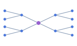 | Organize several branches around a topic. |
| [Indented tree `indented`](#config-layout-indented) | 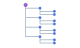 | Show a file directory, menu, or category hierarchy. |
| [Fishbone diagram `fishbone`](#config-layout-fishbone) | 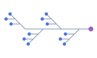 | Show a problem, categories of causes, and individual causes. |

</div>

Switch layouts in the canvas to compare how they arrange the same data. When creating a graph, pass the chosen `layout`. For indented trees and fishbone diagrams, also set the matching polyline router in `edge`.

<NodeDocExample id="layout-tree" locale="en" view="preview" />

#### Mind map (mindmap) [#config-layout-mindmap]

Branches extend horizontally from a central topic. This example uses ID prefixes to keep A and C and their descendants on the left, and B and D and their descendants on the right. Extra space around first-level branches keeps leaves from overlapping.

```ts
import type { GraphNode, LayoutConfig } from '@antv/g6-lite';

const leftBranches = new Set(['A', 'C']);
const layout: LayoutConfig = {
  type: 'mindmap',
  direction: 'H',
  levelGap: 100,
  nodeGap: 24,
  getWidth: () => 16,
  getHeight: (node: GraphNode) => node.id.length === 1 ? 64 : 16,
  getSide: (node: GraphNode) => leftBranches.has(node.id[0]) ? 'left' : 'right',
};
```

| Property | Description | Type | Default |
| --- | --- | --- | --- |
| `direction` | `'LR'` places branches on the right, `'RL'` on the left, and `'H'` uses `getSide` to choose a side. Without a callback, all branches go on the right. | `'H' \| 'LR' \| 'RL'` | `'H'` |
| `levelGap` | Horizontal gap between parent and child boundaries. | `number` | `120` |
| `nodeGap` | Vertical gap between adjacent children on the same side. | `number` | `30` |
| `branchColors` | Writes the branch color to `data._branchColor` for style functions to read. | `string[]` | Built-in palette of 10 colors |
| `getWidth` | Gets the node width. | `(node: GraphNode) => number` | Returns `100` |
| `getHeight` | Gets the node height. | `(node: GraphNode) => number` | Returns `40` |
| `getSide` | Chooses the side for a branch. The callback's node contains only `id` and `data`. | `(node: GraphNode, index: number, parentSide?: 'left' \| 'right') => 'left' \| 'right'` | Returns `'right'` |

#### Indented tree (indented) [#config-layout-indented]

Each node occupies a row. Children appear below their parents and indent farther at each level. Use `indent` for horizontal spacing and `rowHeight` for vertical spacing.

```ts
const layout: LayoutConfig = { type: 'indented', indent: 72, rowHeight: 30 };
const edge: EdgeConfig = { type: 'polyline', style: { router: 'indented', endArrow: false } };
```

| Property | Description | Type | Default |
| --- | --- | --- | --- |
| `indent` | Horizontal offset per depth. | `number` | `80` |
| `rowHeight` | Vertical distance between consecutive node rows. | `number` | `40` |
| `direction` | `'LR'` indents to the right, and `'RL'` indents to the left. | `'LR' \| 'RL'` | `'LR'` |
| `rootId` | Specifies the root node ID. | `string` | First parentless node, then the first node |
| `nodeColors` | A nonempty palette writes colors to `data._nodeColor` by depth. | `string[]` | — |
| `edgeColors` | A nonempty palette writes colors to node `data._edgeColor` by depth for edge style functions to read. | `string[]` | — |

#### Fishbone diagram (fishbone) [#config-layout-fishbone]

Use three levels for a problem, categories of causes, and individual causes. `categoryGap` spaces the categories along the spine and `categoryDistance` moves them away from it.

```ts
const layout: LayoutConfig = { type: 'fishbone', categoryGap: 156, categoryDistance: 130, itemHStep: 54 };
const edge: EdgeConfig = { type: 'polyline', style: { router: 'fishbone', endArrow: false } };
```

| Property | Description | Type | Default |
| --- | --- | --- | --- |
| `direction` | Layout direction. `'RL'` mirrors horizontal positions. | `'LR' \| 'RL'` | `'LR'` |
| `categoryGap` | Distance between neighboring categories along the spine. | `number` | `180` |
| `categoryDistance` | Vertical distance from a category node to the horizontal spine. | `number` | `200` |
| `itemHStep` | Extra horizontal offset from the diagonal branch for each individual cause. | `number` | `20` |
| `getWidth` | Gets node width for positioning the root and items. | `(node: GraphNode) => number` | Returns `80` |
| `getHeight` | Gets node height. The layout calls this function and currently uses only width to calculate positions. | `(node: GraphNode) => number` | Returns `30` |
| `itemGap` | Declared in the type. The current runtime does not read it. | `number` | — |

### Layout options [#config-library-layout-fields]

Set the layout `type` and its options in `layout`. For example, `layout: { type: 'dagre', rankdir: 'LR' }` arranges a flow from left to right.

| Layout type | Example options | Effect |
| --- | --- | --- |
| Hierarchical `dagre` | `rankdir: 'LR', nodesep: 32, ranksep: 80` | Arranges layers left to right, with 32 units between nodes in a layer and 80 between layers. |
| Grid `grid` | `cols: 4` | Arranges nodes in four columns. Use `rows` to set the row count. |
| Circular `circular` | `radius: 120` | Places nodes on a circle with a radius of 120 units. |
| Concentric `concentric` | `sortBy: 'degree'` | Places nodes with more connections closer to the center. |
| Radial `radial` | `focusNode: 'A', unitRadius: 60` | Centers the rings on the node with ID `A`, with 60 units between rings. |
| Force-directed `force`, `d3-force` | `linkDistance: 100` | Aims to place directly connected nodes 100 units apart. |
| `force-atlas2` | `kr: 8, kg: 2` | Higher `kr` pushes nodes farther apart. Higher `kg` pulls them toward the center. |
| `fruchterman` | `gravity: 12` | Higher `gravity` pulls nodes closer to the center. |
| `mds` | `linkDistance: 80` | Uses 80 units as the target distance between directly connected nodes. |
| Random `random` | `width: 800, height: 600, center: [400, 300]` | Places nodes randomly inside an 800 × 600 area centered on `[400, 300]`. |

### Usage example [#config-example-layout]

<NodeDocExample id="layout-switch" locale="en" focus="layout-options" view="code" />

### Rendered result [#config-example-layout-result]

Switch layouts to compare how the same graph is arranged.

<NodeDocExample id="layout-switch" locale="en" view="preview" />

See the [Layout guide](/en/docs/guides/layout) for algorithm options, computation defaults, and Worker behavior.

<span id="supported-layouts" />
<span id="options-layout-code-and-rendered-result" />
<span id="computation-defaults" />
<span id="functional-tree-layouts" />
<span id="mindmap" />
<span id="indented" />
<span id="fishbone" />
<span id="worker" />
<span id="coordinates-and-runtime" />

<span id="interactions" style={{ display: 'block', scrollMarginTop: '8rem' }} />

## BehaviorOption[] [#options-behaviors]

<span id="behavioroption" />
<span id="built-in-index" />

<div className="effect-table">

| type | Preview | Action and result | Dedicated options |
| --- | --- | --- | --- |
| [`zoom-canvas`](/en/docs/guides/behavior-zoom-canvas) | 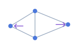 | Wheel zoom centered on the canvas | sensitivity, minZoom, maxZoom |
| [`drag-canvas`](/en/docs/guides/behavior-drag-canvas) | 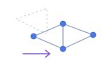 | Left-button pan starting on empty canvas | ignoreModifierKeys |
| [`drag-node`](/en/docs/guides/behavior-drag-node) | 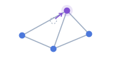 | Move a node, all selected nodes when dragging a selected node, or a Combo group | None |
| [`drag-edge`](/en/docs/guides/behavior-drag-edge) | 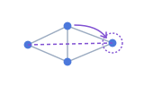 | Emits drag/drop results; does not update endpoints or draw a temporary edge | None |
| [`click-select`](/en/docs/guides/behavior-click-select) | 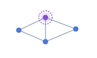 | Toggle selected on nodes and edges | multiple, trigger |
| [`brush-select`](/en/docs/guides/behavior-brush-select) | 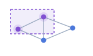 | Rectangle selection by node centers | key; throttleMs is not forwarded |
| [`lasso-select`](/en/docs/guides/behavior-lasso-select) |  | Polygon selection by node centers | key; throttleMs is not forwarded |
| [`highlight-node`](/en/docs/guides/behavior-highlight-node) | 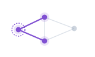 | Emphasize a hovered node and adjacent nodes/edges | None |
| [`highlight-edge`](/en/docs/guides/behavior-highlight-edge) | 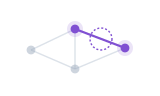 | Emphasize a hovered edge and endpoints | None |
| [`hover-highlight`](/en/docs/guides/behavior-hover-highlight) | 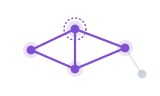 | Emphasize neighborhoods or edges, optionally dim others | degree, inactiveState |
| [`tooltip`](/en/docs/guides/behavior-tooltip) |  | Node/edge hover or click overlay | See TooltipOptions |

</div>

<span id="options-behaviors-code-and-rendered-result" />

### Usage example [#config-example-behaviors]

<NodeDocExample id="behavior-selection" locale="en" focus="behavior-options" view="code" />

### Rendered result [#config-example-behaviors-result]

Brush from empty space, Shift-click to add nodes, then drag a selected node.

<NodeDocExample id="behavior-selection" locale="en" view="preview" />

**Detailed options and interaction rules**

### Navigation and dragging [#navigation-and-dragging]

| Property | Description | Type | Default |
| --- | --- | --- | --- |
| zoom-canvas.sensitivity | Multiplier for the normalized wheel-delta percentage. | number | `1` |
| zoom-canvas.minZoom | Minimum wheel zoom factor. | number | `0.1` |
| zoom-canvas.maxZoom | Maximum wheel zoom factor. | number | `20` |
| drag-canvas.ignoreModifierKeys | Leaves drag gestures with Shift, Ctrl, or Meta for brush or lasso selection. | boolean | `true` |

All three zoom options require finite positive numbers; invalid individual values use their defaults. If the resulting minZoom ≥ maxZoom, all three options reset to defaults. Same-direction wheel events merge within a frame, opposite direction replaces pending input, and each frame is capped at 15%. Line deltas multiply by 16, page deltas by canvas CSS height. Bounds constrain wheel behavior, not programmatic zoomBy or fitView.

drag-node starts after more than 3 client pixels of left-button movement. It does not rerun layout, and a later layout can overwrite moved positions. drag-edge starts on a hit edge, choosing the nearer endpoint, target on ties. It emits edge:dragstart/drag/dragend. A dragend reconnected result proposes a valid node drop; it does not indicate changed data. Apply endpoints through application data and public methods such as setData. Use the batch form of `updateEdgeData()` to change `source` and `target`.

### Selection [#selection]

| Property | Description | Type | Default |
| --- | --- | --- | --- |
| click-select.multiple | When enabled, hold `trigger` while clicking to append to the selection. | boolean | `false` |
| click-select.trigger | Modifier for appending to the selection. `'ctrl'` maps to Ctrl and `'meta'` to Meta. | shift / ctrl / meta | `'shift'` |
| `brush-select.key` | Modifier for brush selection. `null` needs no modifier, and `'ctrl'` accepts Ctrl or Meta. | `'shift' \| 'ctrl' \| null` | `null` |
| `brush-select.throttleMs` | Declared in the type. Graph uses a 100 ms interval and finalizes on release. | `number` | — |
| `lasso-select.key` | Modifier for lasso selection. `null` needs no modifier, and `'ctrl'` accepts Ctrl or Meta. | `'shift' \| 'ctrl' \| null` | `null` |
| `lasso-select.throttleMs` | Declared in the type. Graph uses a 100 ms interval and finalizes on release. | `number` | — |

click-select toggles an already selected element off. Clicking an unselected element without the append modifier clears node and edge selections first; empty canvas clears them too. It does not select Combos.

Brush starts on non-node surfaces (canvas, edge, Combo) and tests node centers. Each update replaces all node selected states, without clearing edges. Lasso clears only nodes from its own previous selection, retaining selections from other sources; at least three samples form a valid polygon. Do not bind both area-selection behaviors to the same gesture.

Area selection emits brush:select/end or lasso:select/end rather than per-node node:selectchange. select is emitted for nonempty results; end can return empty nodeIds. Listening only to node:selectchange misses other selection sources.

### Highlighting [#highlighting]

| Property | Description | Type | Default |
| --- | --- | --- | --- |
| hover-highlight.degree | Neighbor traversal depth. Use a finite nonnegative integer. The current implementation uses the supplied value. | number | `1` |
| hover-highlight.inactiveState | Dimming state for other elements. A common choice is `'inactive'` with corresponding node and edge state styles. | string | — |

highlight-node and highlight-edge control renderer emphasis without writing highlight states. hover-highlight writes highlight and optional inactiveState, cleans up its tracked states on leave, and freezes hover during node/Combo dragging.

degree controls neighbor traversal, but directly incident edges and endpoints are always included, so degree: 0 does not isolate the hovered node. Enabling both built-in highlight-node + highlight-edge combines them into hover-highlight; state effects differ from using either alone. Prefer hover-highlight directly instead of stacking overlapping hover behaviors.

### TooltipOptions [#tooltipoptions]

| Property | Description | Type | Default |
| --- | --- | --- | --- |
| trigger | Tooltip trigger. In `'click'` mode, clicking the same element again or clicking the canvas hides it. | hover / click | `'hover'` |
| getContent | Returns the tooltip content. | (ctx: TooltipContext) => string / HTMLElement | Node `data.label` or ID, edge `data.label` or source → target |
| enable | Return `false` to suppress this display attempt. | (ctx: TooltipContext) => boolean | Allowed to display |
| offset | Offset from the pointer in CSS pixels. | [number, number] | `[10, 10]` |
| delay | Delay in milliseconds before the first hover display. Click displays immediately. | number | `80` |
| className | Tooltip CSS class. | string | `g6lite-tooltip` |
| container | Mount point and collision boundary. | HTMLElement | `document.body` |

delay uses browser timer semantics and offset does not validate finiteness. Prefer finite values and nonnegative delay. Default text uses textContent; custom strings use innerHTML, so escape untrusted values or return an HTMLElement populated with textContent. No visual skin is provided, and pointer-events is none. Use an application overlay for clickable content.

#### TooltipContext [#tooltipcontext]

| Property | Description | Type | Default |
| --- | --- | --- | --- |
| itemType | Hit category, excluding Combo | node / edge | — |
| nodeId | Node hits | Optional string | — |
| edgeId / edgeIndex | Edge hits | Optional string / number | — |
| source / target | Edge endpoint ids | Optional string | — |
| data | Node or edge business data | Optional `Record<string, unknown>` | — |
| event | Original event with clientX/clientY; this context has no nativeEvent field | MouseEvent | — |

Body-mounted overlays use viewport positioning and flip at boundaries. For a custom container, verify positioning ancestors, scrolling, and clipping. See the [Tooltip guide](/en/docs/guides/behaviors#tooltip).

<span id="custom-behavior-contract" style={{ display: 'block', scrollMarginTop: '8rem' }} />

### Custom interaction contract [#custom-interaction-contract]

| Member | Signature | Contract |
| --- | --- | --- |
| Optional init | `(context: ExtensionContext, options: Readonly<TOptions>) => void` | options includes type; Readonly is a type constraint, not runtime freezing on this path |
| Required getEvents | `() => BehaviorEventHandlers<TEventMap>` | Partial event-to-function map, automatically bound and unbound |
| Optional destroy | () => void | Clean up owned DOM, listeners, timers, and asynchronous tasks |

`BehaviorExtension<TOptions extends BehaviorOptions = BehaviorConfig, TEventMap extends object = GraphEventMap>`. BehaviorEventHandlers maps each event argument tuple to a handler. `destroy` has zero arguments. Applications can call `graph.emit()` to invoke custom handlers. Augment `GraphEventMap` to check emitted arguments and infer listener parameter types. See the [custom event example](/en/docs/guides/events/custom).

Pass a factory that returns a fresh instance directly to `register()`. The lifecycle is create → init → getEvents → destroy. There is no promised update hook; remounting destroys and recreates instances. Registry replacement does not immediately replace mounted instances.

Creation, init, getEvents, and handler synchronous errors are isolated and logged with behavior/phase details. Handle asynchronous rejections yourself. Use context.data/state/viewport, requestRender, and isDestroyed; do not write through snapshots or depend on internal renderer/eventEmitter or deprecated context.graph. See [Custom interactions](/en/docs/guides/custom-behavior) for implementation and cleanup.

[Interaction guide](/en/docs/guides/behaviors)

<span id="theme" style={{ display: 'block', scrollMarginTop: '8rem' }} />

## ThemeOption [#options-theme]

`theme` sets the default canvas and element appearance through a built-in theme and optional style overrides.

| Value | Effect |
| --- | --- |
| `'light'` / `'dark'` | Built-in light and dark themes. Defaults to `'light'`. |
| `{ type, ...tokens }` | Select a base theme, then override values such as colors and sizes. |

| Property | Description | Type | Default |
| --- | --- | --- | --- |
| `type` | Required. Base preset for object entries. Omitting `theme` uses `'light'`. | `'light' \| 'dark'` | — |

<span id="themeoption" />

Objects require `type`; all tokens are optional fixed values, without callbacks. Resolution starts from the preset and replaces top-level fields. Explicit undefined overwrites a preset value; omit fields you do not need to change.

### ThemeTokens [#themetokens]

Built-in defaults follow. Units and valid values match the corresponding [node styles](/en/docs/guides/node#nodestyleconfig) and [edge styles](/en/docs/guides/edge#basic-styles); theme resolution adds no numeric validation or normalization.

| Property | Description | Type | Default |
| --- | --- | --- | --- |
| `nodeFill` | Default node fill | `string` | `#1783FF` |
| `nodeSize` | Default node size | `number` | `24` |
| `nodeStroke` | Default node outline color | `string` | `light` `#fff` / `dark` `#333` |
| `nodeStrokeWidth` | Default node outline width | `number` | `0` |
| `edgeStroke` | Default edge color | `string` | `light` `#99ADD1` / `dark` `#637088` |
| `edgeLineWidth` | Default edge lineWidth | `number` | `1` |
| `edgeArrow` | Default edge endArrow | `boolean` | `true` |
| `canvasBackground` | Graph canvas clear color | `string` | `light` `#fff` / `dark` `#1a1a1a` |
| `edgeDefaultColor` | Fallback when edgeStroke is absent | `string` | `light` `#99ADD1` / `dark` `#637088` |
| `edgeCategoryPalette` | Readable palette; no automatic data mapping | `string[]` | `light` 10 colors, below / `dark` 10 colors, below |
| `nodeStateStyles` | Default node state styles | `Partial<Record<NodeState, NodeStateStyleOverride>>` | `light` Below / `dark` Below |
| `edgeStateStyles` | Default edge state styles | `Partial<Record<EdgeState, EdgeStateStyleOverride>>` | Below |

Both presets define edgeStroke, so changing only edgeDefaultColor does not change default edge colors. Themes have no label, icon, or Combo tokens; configure those styles separately.

#### Complete category palettes

light: `['#1783FF', '#00C9C9', '#F08F56', '#D580FF', '#7863FF', '#DB9D0D', '#60C42D', '#FF80CA', '#2491B3', '#17C76F']`.

dark: `['#0F55A6', '#008383', '#9C5D38', '#8B53A6', '#4E40A6', '#8F6608', '#3E801D', '#A65383', '#175E75', '#0F8248']`.

For category colors, read edgeCategoryPalette from resolveTheme and map business categories to colors in a function assigned to `edge.style.stroke`. Setting the palette alone does not recolor edges.

### State presets [#state-presets]

The node emphasis outline is `#163B65` in light and `#B7D3FF` in dark. Only overridden fields are listed below.

| State | nodeStateStyles | edgeStateStyles |
| --- | --- | --- |
| `active` | haloWidth: 8, opacity: 1 | stroke: #1783FF, opacity: 1 |
| `selected` | stroke: emphasis, strokeWidth: 2, haloWidth: 12, opacity: 1 | stroke: #1783FF, opacity: 1 |
| `disabled` | opacity: 0.15 | opacity: 0.15, lineDash: [4, 4] |
| `highlight` | stroke: emphasis, strokeWidth: 1, opacity: 1 | stroke: #1783FF, opacity: 1 |
| `inactive` | opacity: 0.25 | opacity: 0.25 |

See [node state styles](/en/docs/guides/node#options-node-state-styles) and [edge state styles](/en/docs/guides/edge#options-edge-state-styles) for supported fields. The renderer hides hidden directly and skips overrides for default. Multiple states apply in list order; later states overwrite the same fields. An active node gets halo 8 when its halo is 0; selected has a minimum halo of 12. haloWidth: 0 cannot disable these built-in effects.

### Usage example [#config-example-theme]

<NodeDocExample id="theme-switch" locale="en" focus="theme-options" view="code" />

### Rendered result [#config-example-theme-result]

Switch between light, dark, and custom themes to compare the background and element styles.

<NodeDocExample id="theme-switch" locale="en" view="preview" />

[Theme guide](/en/docs/guides/theme)

**Theme precedence and runtime updates**

### Code and rendered result [#options-theme-code-and-rendered-result]

Choose light, dark, or brand. Default uses base theme styles; Selected and Disabled use state styles. The brand theme preserves other preset node states. Label colors are updated separately on each switch.

[See the example canvas for this section](#config-example-theme).

### Precedence [#precedence]

For field-object base styles: explicit node/edge.style fields > registered extension defaults > theme tokens > renderer fallbacks. Whole-object node style functions use a compatibility path with different defaults and state handling; see [Style functions](/en/docs/guides/node#options-node-style-callbacks).

State styles apply after base styles. For each state, the renderer chooses the object from node/edge.stateStyles, then extension state styles, then theme state styles. Once an object is chosen, missing fields are not filled from lower levels. An empty object also suppresses the theme override for that state.

**Preserving preset state styles**

A theme's nodeStateStyles or edgeStateStyles replaces the entire preset map. Spread both levels to keep other states and other fields within the same state:

```ts
import { resolveTheme, type ThemeOption } from '@antv/g6-lite';

const base = resolveTheme('light');
const theme: ThemeOption = {
  type: 'light',
  nodeStateStyles: {
    ...base.nodeStateStyles,
    selected: { ...base.nodeStateStyles?.selected, stroke: '#00A876' },
  },
};
```

### resolveTheme [#resolvetheme]

Resolve tokens from the preset and overrides in `ThemeOption`. To apply a theme to an existing graph, use [updateOptions](/en/docs/api/graph#graph-lifecycle-updateoptions).

```ts
import { resolveTheme, type ThemeTokens } from '@antv/g6-lite';

const tokens: ThemeTokens = resolveTheme({ type: 'dark', nodeSize: 32 });
```

Accepts ThemeOption and returns `ThemeTokens`. Fields remain optional in the public type; account for undefined when reading them. The function creates a top-level object and copies the palette array; state maps and nested objects are not deeply cloned. Treat results as read-only and construct new state objects using spreads, rather than mutating shared objects.

### Runtime updates [#options-theme-runtime-updates]

`graph.updateOptions({ theme: nextTheme })` replaces the entire previous theme option and refreshes styles. It does not accumulate previous custom tokens, rerun layout, or call fitView.

Switching from `{ type: 'light', nodeSize: 36 }` to `'dark'` restores default node size 24; explicit node.style.size still wins. Construct a complete nextTheme to retain brand tokens. The application must synchronize label colors, page backgrounds, and system dark mode separately.

Continue with [Themes](/en/docs/guides/theme), [Graph.updateOptions](/en/docs/api/graph), or [Default themes and states](/en/docs/examples/default-theme).

<span id="plugins-and-transforms" style={{ display: 'block', scrollMarginTop: '8rem' }} />

<span id="options-transforms-plugins" style={{ display: 'block', scrollMarginTop: '8rem' }} />

## TransformOption[] [#transforms]

Custom transforms process the full input in array order before layout. The built-in `process-parallel-edges` computes edge offsets after the graph data is applied. See the [Transforms](/en/docs/guides/transform-overview) for configuration examples.

| Property | Description | Type | Default |
| --- | --- | --- | --- |
| `type` | Required. Transform name for object entries. You can also pass a registered name or `process-parallel-edges` directly. | `string` | — |
| `options` | Registered transforms define their own options. The built-in transform uses [ParallelEdgesConfig](#config-parallel-edge-fields). | `Record<string, unknown> \| ParallelEdgesConfig` | `{}` |

### Usage example [#config-example-transforms]

<NodeDocExample id="extension-transform" locale="en" focus="config-transforms" view="code" />

### Rendered result [#config-example-transforms-result]

The transform adds a prefix to node labels.

<NodeDocExample id="extension-transform" locale="en" view="preview" />

**Transform options**

GraphOptions.transforms?: TransformOption[] defaults to no registered transformations. Each entry is a string or an object with type and optional options. options is Record&lt;string, unknown&gt;; the special parallel-edge entry also accepts ParallelEdgesConfig.

```ts
import type { TransformOption } from '@antv/g6-lite';
export const transforms: TransformOption[] = [
  { type: 'app-normalize', options: { prefix: 'Service' } },
];
```

This is configuration only. Register app-normalize as TransformExtension with beforeRender. String form sends {} to init / update; object form sends only options, excluding the outer type. Do not put prefix on the outer object.

Entries execute in order before layout. The same name at two positions has two instances. A later render / setData reuses the same position/name and calls update with complete options, not a diff. Removal or name changes release old instances.

process-parallel-edges is a built-in special case that does not invoke a registered Transform. See [parallel-edge options](/en/docs/guides/edge#entries-and-precedence) for fields, disabling, and precedence over the transform entry.

## PluginOption[] [#plugins]

`plugins` enables registered plugins and mounts them in the graph container.

| Property | Description | Type | Default |
| --- | --- | --- | --- |
| `type` | Required. Registered plugin name. | `string` | — |
| `[key: string]` | Plugin-specific options passed as top-level fields. | `unknown` | — |

### Usage example [#config-example-plugins]

<NodeDocExample id="extension-plugin" locale="en" focus="activate" view="code" />

### Rendered result [#config-example-plugins-result]

The plugin displays a click counter inside the graph container.

<NodeDocExample id="extension-plugin" locale="en" view="preview" />

[Extension guide](/en/docs/guides/extensions)

**Plugin options and extension lifecycle**

GraphOptions.plugins?: PluginOption[] defaults to empty. Every entry is an object with type: string; other top-level fields are business options. PluginOptions&lt;TType&gt; can constrain names and fields. There is no string shorthand.

```ts
import type { PluginOption } from '@antv/g6-lite';
export const plugins: PluginOption[] = [
  { type: 'app-counter', caption: 'Visits' },
];
```

Register app-counter as PluginExtension. init receives the whole object, including type and caption. A nested options object is not automatically flattened. mount receives the Graph DOM container. Repeated same-named entries instantiate separately; names are not deduplicated.

### Calls and changes [#calls-and-changes]

| Operation | Registered Transform | Plugin |
| --- | --- | --- |
| First render | Create, init, transform input | Create, init, mount |
| Repeated render | Reuse matching position/name; update then transform | Destroy old instance; create and mount again |
| setData | Transform new input, then layout | Does not remount |
| layout / incremental writes | Do not rerun registered transforms | Do not remount |
| Graph.destroy | Destroy current instances | Destroy; release plugin-owned resources |

Changing Transform or Plugin configuration requires a new Graph. Replace behaviors independently with [setBehaviors()](/en/docs/api/graph#setbehaviors).

### Options and support boundaries [#options-and-support-boundaries]

Extensions validate their own options; fields do not acquire engine meaning merely by appearing in GraphOptions. Build instance state from current values and defaults in init / update. Do not mutate received read-only options.

Registered Transforms return GraphData synchronously, not a Promise. Plugins own asynchronous completion, cancellation, and errors. Unknown names are skipped rather than activated. See [runtime contracts](/en/docs/api/extensions#extension-runtime) for errors/cleanup and [registration](/en/docs/api/graph#extension-registration) for isolation.

<span id="mounting-and-updates" />

## Runtime changes

After creation, use [updateOptions()](/en/docs/api/graph#graph-lifecycle-updateoptions) for styles and interactions. Replace data with [setData()](/en/docs/api/graph#graph-data-mutations-setdata), or change layout with [setLayout() and layout()](/en/docs/api/graph#graph-layout).

After the first render completes, use [updateOptions()](/en/docs/api/graph#graph-lifecycle-updateoptions) to update nodes, edges, labels, the theme, or interactions. Earlier calls throw. Calls after destruction return immediately.

```ts
graph.updateOptions(
  options: Partial<Pick<GraphOptions, 'node' | 'edge' | 'label' | 'theme' | 'behaviors'>>,
): void
```

| Option | Merge rule |
| --- | --- |
| `node`, `edge` | Shallow-merge top-level fields and keep omitted fields. |
| `node.style` | Merge fields when both values are objects. If either value is a style function, replace the entire value. |
| `edge.style` | Merge object fields. |
| `node.stateStyles`, `edge.stateStyles` | Replace the entire state map. Pass a complete map to keep other states. |
| `label` | Shallow-merge top-level fields. |
| `theme` | Replace the whole option, then resolve the preset. |
| `behaviors` | Passing an array replaces the entire list. Omit it or pass `undefined` to keep the current list. Pass `[]` to disable all behaviors. |

You can also change interactions with [setBehaviors()](/en/docs/api/graph#setbehaviors). Use [data mutations](/en/docs/api/graph#graph-data-mutations) for data and Combos and [setLayout() and layout()](/en/docs/api/graph#graph-layout) for layout. Create a Graph with new options to change the container, `autoFit`, plugins, or transforms.
