import { NodeDocExample as LayoutDocExample } from '@/components/node-doc-example';

Configure the layout in `new Graph()` through `layout`. See the [Layout overview](/en/docs/guides/layout-overview) to choose an algorithm.

## LayoutConfig [#choose-a-layout]

| Field | Purpose |
| --- | --- |
| `type` | Algorithm name, such as `dagre` |
| `width`, `height` | Computation bounds, defaulting to canvas dimensions |
| `center` | Layout center for algorithms that use it |
| `worker` | Whether to try computing in a Worker |

Direction and spacing depend on the algorithm. See the [layout reference](/en/docs/api/options#options-layout) for defaults and types.

<span id="supported-layout-types" />

## Supported layouts [#supported-layouts]

The thumbnails show 11 layouts on the same data. Try them in the [layout gallery](/en/docs/examples/layout-gallery) or see the [AntV Layout documentation](https://layout.antv.vision/) for more options.

Layouts marked **Optional** must be imported and registered. See [Optional layouts](/en/docs/guides/layout-overview#optional-layouts).

<div className="effect-table">

| type | Preview | Purpose | Common algorithm options |
| --- | --- | --- | --- |
| [`circular`](/en/docs/guides/layout-circular) | 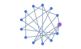 | Circle or spiral | radius, startRadius, endRadius, startAngle, endAngle, clockwise |
| [`concentric`](/en/docs/guides/layout-concentric) | 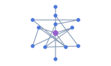 | Rings by importance | sortBy, maxLevelDiff, nodeSize, nodeSpacing, preventOverlap |
| [`grid`](/en/docs/guides/layout-grid) | 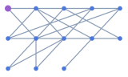 | Rows and columns | rows, cols, begin, sortBy, nodeSize, nodeSpacing, preventOverlap |
| [`random`](/en/docs/guides/layout-random) | 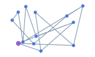 | **Optional.** Random positions | width, height, center |
| [`dagre`](/en/docs/guides/layout-dagre) | 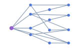 | Directed layers | rankdir: TB/BT/LR/RL, nodesep, ranksep, edgesep, nodeSize, ranker |
| [`force`](/en/docs/guides/layout-force) | 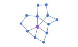 | Force-directed network | linkDistance, nodeStrength, edgeStrength, maxIteration, minMovement |
| [`d3-force`](/en/docs/guides/layout-d3-force) | 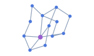 | D3 simulation | linkDistance, nodeStrength, alphaDecay, alphaMin; use nodeStrength, not charge |
| [`force-atlas2`](/en/docs/guides/layout-force-atlas2) | 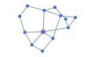 | ForceAtlas2 network | kr, kg, barnesHut, prune, maxIteration |
| [`fruchterman`](/en/docs/guides/layout-fruchterman) | 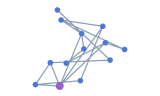 | Fruchterman network | gravity, speed, maxIteration, minMovement |
| [`radial`](/en/docs/guides/layout-radial) | 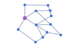 | **Optional.** Rings around a focus | focusNode, unitRadius, linkDistance, preventOverlap |
| [`mds`](/en/docs/guides/layout-mds) | 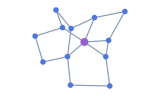 | **Optional.** Positions from graph distances | linkDistance, center |

</div>

Rendered node sizes are not automatically passed to algorithms. For overlap avoidance, also set the algorithm's nodeSize/nodeSpacing or equivalent options; preventOverlap alone does not ensure agreement with drawn sizes.

### Computation defaults [#computation-defaults]

G6Lite injects or rewrites the following options; explicit values win. These rules apply to library layouts, not the three functional tree layouts.

| Algorithm / option | Default or rule |
| --- | --- |
| All library layouts: `animate` | false when omitted; Graph applies positions after computation rather than drawing every iteration |
| `iterations` | Mapped to maxIteration only when maxIteration is absent, then removed. It is not a universal iteration control for every algorithm |
| force / fruchterman, fewer than 1000 nodes | maxIteration: 100, minMovement: 1 |
| force / fruchterman, 1000–5000 nodes | maxIteration: 200, minMovement: 1.5 |
| force / fruchterman, more than 5000 nodes | maxIteration: 50, minMovement: 2 |
| force-atlas2 | barnesHut: true; prune defaults to false above 200 nodes; maxIteration: 100, or 50 above 5000 nodes |
| d3-force | alphaDecay: 0.1; linkDistance: max(200, √node count × 80) |

Main-thread d3-force is ticked manually up to 300 times, checking alphaMin (default 0.001). The Worker path awaits the algorithm's completion; the paths do not guarantee identical positions. Other internal defaults belong to the installed algorithm version.

<span id="preview" />

## Preview [#options-layout-code-and-rendered-result]

Use **Layout** to compare Grid, Circular, and Dagre on the same data. The code shows the parameters for each layout.

<LayoutDocExample id="layout-switch" locale="en" focus="layout-options" />

## Tree example

Set parent-child relationships in `edges`, with the parent as `source` and the child as `target`. Compare mind map, indented, and fishbone layouts in the [tree layout example](/en/docs/guides/layout-trees#configuration-and-example).

### Functional tree layouts [#functional-tree-layouts]

Use a connected tree with one root and no cycles.

<div className="effect-table">

| type | Preview | Purpose |
| --- | --- | --- |
| [`mindmap`](/en/docs/guides/layout-mindmap) | 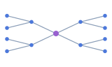 | **Optional.** Organize a hierarchy into branches |
| [`indented`](/en/docs/guides/layout-indented) | 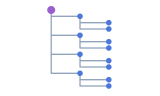 | **Optional.** Show a tree as a list |
| [`fishbone`](/en/docs/guides/layout-fishbone) | 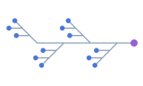 | **Optional.** Group categories and items along a spine |

</div>

#### mindmap [#mindmap]

| Option | Type | Default / behavior |
| --- | --- | --- |
| `direction` | `'H' \| 'LR' \| 'RL'` | H; LR places branches right, RL left; H uses getSide, whose default also returns right |
| `levelGap` | `number` | 120, horizontal gap between parent and child boundaries |
| `nodeGap` | `number` | 30, gap between adjacent children on one side |
| `branchColors` | `string[]` | Built-in 10 colors; writes data._branchColor, which needs an explicit style function to affect colors |
| `getWidth` | `(node: GraphNode) => number` | Returns 100 |
| `getHeight` | `(node: GraphNode) => number` | Returns 40 |
| `getSide` | `(node: GraphNode, index: number, parentSide?: 'left' \| 'right') => 'left' \| 'right'` | Returns right; node contains only id and data |

The first parentless input node becomes root; otherwise the first node does. Root position is (0, 0). Use levelGap/nodeGap; legacy hGap/vGap names are not supported.

#### indented [#indented]

| Option | Type | Default / behavior |
| --- | --- | --- |
| `indent` | `number` | 80, horizontal offset per depth |
| `rowHeight` | `number` | 40, gap between consecutive DFS rows |
| `direction` | `'LR' \| 'RL'` | LR; RL uses negative horizontal positions |
| `rootId` | `string` | Explicit root, otherwise first parentless node, then first node |
| `nodeColors` | `string[]` | Omitted: no color written; a nonempty palette writes data._nodeColor by depth |
| `edgeColors` | `string[]` | Omitted: no color written; a nonempty palette writes data._edgeColor onto nodes, for edge style functions to read |

Visited nodes also receive data.depth and data._isRoot; root position is (0, 0). Generated metadata does not automatically change visual styles.

#### fishbone [#fishbone]

For root → category → item structures. Deeper nodes do not receive a complete position assignment.

| Option | Type | Default / behavior |
| --- | --- | --- |
| `direction` | `'LR' \| 'RL'` | LR; RL mirrors horizontal positions |
| `categoryGap` | `number` | 180, spacing of categories along the spine |
| `categoryDistance` | `number` | 200, category offset scale from the spine |
| `itemHStep` | `number` | 20, extra horizontal item offset |
| `getWidth` | `(node: GraphNode) => number` | Returns 80; used for root and item positions |
| `getHeight` | `(node: GraphNode) => number` | Returns 30; called, but stored heights currently do not affect positions |
| `itemGap` | `number` | Declared only; the runtime does not read it to adjust spacing |

<span id="coordinates-and-runtime" />

## Rerun layout at runtime

For a graph that has completed render: setLayout replaces the entire configuration. Fit the graph after layout only when needed:

```ts
graph.setLayout({ type: 'dagre', rankdir: 'LR', nodesep: 32, ranksep: 64 });
await graph.layout();
graph.fitView({ padding: 48, maxZoom: 1 });
```

Omit the last line to retain the user's camera. To replace all data, use `await graph.setData(nextData, { fitView: false })`; this still runs the current layout. Updating individual nodes does not itself rerun layout; call layout when needed.

Layout may change existing x/y. Graph's fx/fy override the corresponding final axes, without guaranteeing the algorithm treated them as fixed constraints.

`layout()` applies new coordinates after successful computation. The existing camera, interactions, and renderer stay in use.

## Worker

Graph supplies worker: true when node count ≥ 1000 and worker is omitted, without filtering by algorithm name. Standalone runLayout has no automatic switch. Execution order is registered extension → built-in tree → Worker → main-thread library. Worker creation, cloning, or execution failures fall back to the same main-thread algorithm, which may block again.

Prefer explicit worker: false for function-valued options. See [layout methods](/en/docs/api/graph#layout) for cancellation. Successful configuration does not prove a Worker actually ran.

See the [Worker layout guide](/en/docs/guides/layout-worker) for setup, transfer restrictions, and cancellation examples.

## Common questions

### Why did configuration changes leave nodes in place?

setLayout only stores configuration; follow it with await graph.layout(). updateOptions does not update layout. Call layout after the first render completes.

### Why did the graph move outside the canvas?

layout does not fit the camera automatically. Call fitView after completion when you want the entire graph visible. A graph-coordinate center is not camera fitting.

### Why do tree nodes overlap at the origin or ignore spacing?

Check roots, edge direction, and connectivity. mindmap uses levelGap/nodeGap, not hGap/vGap. fishbone's itemGap is currently ineffective.

## Related

- [Layout configuration reference](/en/docs/api/options#options-layout): fields, defaults, and algorithm boundaries.
- [Graph layout methods](/en/docs/api/graph#graph-layout): rerunning and cancellation.
- [Layout gallery](/en/docs/examples/layout-gallery) · [Performance tuning](/en/docs/metrics/performance#performance-tuning).

**Related runnable examples**

- [Common layout switching](/en/docs/examples/layouts)
- [More layout examples](/en/docs/examples/layout-gallery)
- [Flowchart](/en/docs/examples/flowchart)
- [Indented tree](/en/docs/examples/indented-tree)
- [Radial tree](/en/docs/examples/radial-tree)
- [Call graph](/en/docs/examples/dependency-graph)
- [Organization chart](/en/docs/examples/org-chart)
- [Mind map](/en/docs/examples/mindmap)
- [Fishbone diagram](/en/docs/examples/fishbone)
