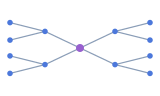
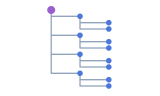
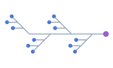
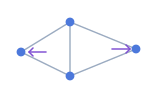
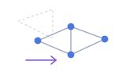
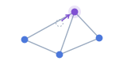
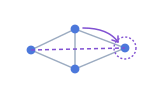
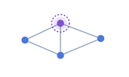
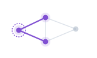
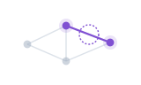

import { NodeDocExample } from '@/components/node-doc-example';

## GraphOptions

`GraphOptions` 用于配置 `new Graph(options)` 创建的图，其中 `container` 和 `data` 为必填项。

<span id="graphoptions-fields" style={{ display: 'block', scrollMarginTop: '8rem' }} />

| 属性 | 描述 | 类型 | 默认值 |
| --- | --- | --- | --- |
| `container` | 必填。指定画布挂载位置。传 CSS 选择器或已挂载且宽高非零的元素，详见[容器要求](/docs/api/graph#new-graph)。 | `string \| HTMLElement` | — |
| `data` | 必填。提供节点、边和可选的 Combo 分组。空图传 `{ nodes: [], edges: [] }`。 | [`GraphData`](#options-data) | — |
| <span id="autofit" style={{ display: 'inline-block', scrollMarginTop: '8rem' }} />`autoFit` | 控制容器尺寸变化后是否重新适配视图。见 [setSize()](/docs/api/graph#setsize)。 | `boolean \| number` 或 [`FitViewOptions`](/docs/api/graph#graph-viewport-fitview) | `false` |
| `label` | 控制节点和边标签的缩放、低缩放隐藏及碰撞隐藏。文字和外观分别在 `node.style`、`edge.style` 中设置。 | [`LabelOptions`](#options-label) | 使用默认缩放与隐藏策略 |
| `node` | 设置节点形状、外观、状态样式、标签和装饰。 | [`NodeConfig`](#options-node) | `circle`，使用主题和内置样式 |
| `edge` | 设置边的形状、线条、箭头、标签和状态样式。 | [`EdgeConfig`](#options-edge) | `line`，使用主题和内置样式 |
| `combo` | 设置所有 Combo 的外观、标签和折叠形态。分组关系由 `data.combos` 和节点的 `comboId` 声明。 | [`ComboConfig`](#options-combo) | 使用默认分组样式 |
| `layout` | 指定布局算法及其参数，用于计算节点位置。 | [`LayoutConfig`](#options-layout) | 使用已有 `x`、`y`，缺省轴为 `0` |
| `behaviors` | 配置缩放、拖拽、选择等交互。显式数组替换默认行为，`[]` 禁用全部行为。 | [`BehaviorOption[]`](#options-behaviors) | `['zoom-canvas', 'drag-canvas']` |
| `transforms` | 启用自定义数据处理或平行边分离。 | [`TransformOption[]`](#transforms) | — |
| `plugins` | 配置要在图容器中挂载的已注册插件。 | [`PluginOption[]`](#plugins) | 无插件 |
| `theme` | 设置画布、节点、边和状态样式使用的默认颜色及其他样式值。 | [`ThemeOption`](#options-theme) | `'light'` |

### autoFit / FitViewOptions [#config-autofit-fields]

`autoFit: false` 在容器尺寸变化时保留当前视图。`true` 使用适配系数 `0.9`，正数可指定系数。对象写法接受下表字段。首次渲染会适配视图。

| 属性 | 描述 | 类型 | 默认值 |
| --- | --- | --- | --- |
| `padding` | 统一留白，或按上、右、下、左指定。单位为 CSS 像素。 | `number \| [number, number, number, number]` | `0` |
| `minZoom` | 适配时的最小缩放倍数。 | `number` | `0.1` |
| `maxZoom` | 适配时的最大缩放倍数。 | `number` | `20` |

### 使用示例 [#graphoptions-example]

这段配置创建一张从左到右排列的调用关系图，并将 Cache 和 Database 放入 Storage 分组。

<NodeDocExample id="graph-options" locale="zh" view="code" />

### 示例效果 [#graphoptions-preview]

<NodeDocExample id="graph-options" locale="zh" view="preview" />

<span id="图数据" style={{ display: 'block', scrollMarginTop: '8rem' }} />

## GraphData [#options-data]

`data` 为 `new Graph()` 或 `setData()` 提供节点、边和分组。

<span id="graphdata" style={{ display: 'block', scrollMarginTop: '8rem' }} />

| 属性 | 描述 | 类型 | 默认值 |
| --- | --- | --- | --- |
| `nodes` | 必填。节点列表。空图传 `[]`。 | [`GraphNode[]`](#graphnode) | — |
| `edges` | 必填。边列表。无边时传 `[]`。 | [`GraphEdge[]`](#graphedge) | — |
| `combos` | 分组列表。 | [`ComboData[]`](#options-combo-combodata) | — |

### 使用示例 [#config-example-data]

<NodeDocExample id="combo-data" locale="zh" focus="graph-data" view="code" />

### 示例效果 [#config-example-data-result]

画布中的节点通过 `comboId` 加入分组，分组通过 `parentId` 嵌套。

<NodeDocExample id="combo-data" locale="zh" view="preview" />

<span id="初始状态与导出" style={{ display: 'block', scrollMarginTop: '8rem' }} />

<Callout type="warn" title="注意">
节点、边和 Combo 使用不同的 ID，并在更新前后保持稳定。边的两端引用已有节点，Combo 的父子关系不能成环。
</Callout>

<span id="节点-graphnode" style={{ display: 'block', scrollMarginTop: '8rem' }} />

## GraphNode [#graphnode]

`GraphNode` 描述 `data.nodes` 里的一个节点。

| 属性 | 描述 | 类型 | 默认值 |
| --- | --- | --- | --- |
| `id` | 必填。节点 ID，供边引用。 | `string` | — |
| `name` | 节点名称，可用于标签。 | `string` | — |
| `data` | 业务数据，例如 `{ score: 80 }`。`cluster` 若提供，须为字符串。 | [`NodeData`](#config-node-data-fields) | — |
| `x` / `y` | 节点的图坐标。省略布局时，缺失的坐标按 `0` 处理。 | `number` | — |
| `fx` / `fy` | 指定布局完成后节点的横坐标或纵坐标。 | `number` | — |
| `states` | 状态名称数组，例如 `['selected']`。 | `ElementState[]` | `[]` |
| `comboId` | 节点所属的 Combo ID，需引用已声明的 Combo。 | `string` | — |

### NodeData [#config-node-data-fields]

| 属性 | 描述 | 类型 | 默认值 |
| --- | --- | --- | --- |
| `cluster` | 业务分组标识，可由布局或样式函数读取。 | `string` | — |
| `[key: string]` | 应用自定义的节点业务数据。 | `unknown` | — |

```ts
import { Graph, type GraphNode } from '@antv/g6-lite';

// 省略 layout 时，节点按 x、y 定位。
const nodes: GraphNode[] = [
  { id: 'A', x: 100, y: 40 },
  { id: 'B', x: 200, y: 80 },
];
const graph = new Graph({
  container: '#container',
  data: { nodes, edges: [] },
  node: { style: { fill: '#1677ff', size: 24, label: (node) => node.id } },
});
await graph.render();

// 启用圆形布局，通过 setData() 传入 fx 固定 A 的横坐标。
graph.setLayout({ type: 'circular' });
await graph.setData({
  nodes: [{ id: 'A', fx: 100 }, { id: 'B' }],
  edges: [],
});

// 渲染后更新 A 的业务数据。
graph.updateNodeData('A', { score: 80 });
```

<span id="边-graphedge" style={{ display: 'block', scrollMarginTop: '8rem' }} />

## GraphEdge [#graphedge]

`GraphEdge` 描述 `data.edges` 里连接两个节点的一条边。

| 属性 | 描述 | 类型 | 默认值 |
| --- | --- | --- | --- |
| `id` | 边 ID。全量替换数据时会重新生成，需保持稳定时请显式传入。 | `string` | 自动生成 |
| `source` | 必填。起点节点 ID。 | `string` | — |
| `target` | 必填。终点节点 ID。 | `string` | — |
| `data` | 业务数据。 | `Record<string, unknown>` | — |
| `states` | 状态名称数组，例如 `['selected']`。 | `ElementState[]` | `[]` |

`source` 与 `target` 相同会形成自环。相同端点间可以有多条 ID 不同的边，见[平行边与自环](#平行边与自环)。

<span id="options-data-combodata" style={{ display: 'block', scrollMarginTop: '8rem' }} />
<span id="combo-combodata" style={{ display: 'block', scrollMarginTop: '8rem' }} />
<span id="节点归属与嵌套" style={{ display: 'block', scrollMarginTop: '8rem' }} />

## ComboData [#options-combo-combodata]

`ComboData` 描述 `data.combos` 里的一个分组，节点通过 `comboId` 加入。

| 属性 | 描述 | 类型 | 默认值 |
| --- | --- | --- | --- |
| `id` | 必填。分组 ID。 | `string` | — |
| `parentId` | 父分组 ID，需引用同一 `combos` 数组中的分组。 | `string` | — |
| <span id="初始折叠" style={{ scrollMarginTop: '8rem' }} />`collapsed` | 传 `true` 时折叠分组，隐藏后代节点及其关联边。 | `boolean` | `false` |
| `style` | 覆盖 [ComboConfig](#options-combo) 中的同名样式字段。 | `Partial<ComboStyleConfig>` | — |
| `data` | 业务数据。 | `Record<string, unknown>` | — |
| <span id="初始状态" style={{ scrollMarginTop: '8rem' }} />`states` | 状态名称数组，例如 `['selected']`。 | `ElementState[]` | `[]` |

<span id="节点" style={{ display: 'block', scrollMarginTop: '8rem' }} />

## NodeConfig [#options-node]

`GraphOptions.node` 使用 `NodeConfig` 设置节点的形状和默认样式，样式函数还可以读取每个 [GraphNode](#graphnode) 的数据，按节点设置外观。

| 属性 | 描述 | 类型 | 默认值 |
| --- | --- | --- | --- |
| `type` | 自定义名称先通过 `register('node', ...)` 注册，实际图元取自扩展的 `base`。 | `'circle' \| 'rect' \| string` | `'circle'` |
| `style` | 设置节点的基础样式。整对象函数的差异见下文。 | [`NodeStyleConfig`](#config-node-style) 或 `(node: GraphNode) => Partial<NodeStyleConfig>` | 使用主题和字段回退值 |
| `stateStyles` | 按状态覆盖基础外观。 | `Partial<Record<ElementState, NodeStateStyleOverride>>` | 使用扩展或主题的状态定义 |
| `labelRenderer` | 指定名称须先注册 label 扩展，且 `style.label` 必须提供非空文本。 | `string` | 内置标签渲染器 |
| `decorations` | 可使用内置 `builtin-badge` 或已注册的 decoration 渲染器。字段见 [NodeDecorationConfig](#config-node-decoration)。 | `NodeDecorationConfig[]` | 无装饰 |

### NodeConfig.style [#config-node-style]

内置节点样式支持固定值和 `(node: GraphNode) => T` 函数。主题和节点扩展可提供默认外观。

| 属性 | 描述 | 类型 | 默认值 |
| --- | --- | --- | --- |
| `fill` | 填充颜色 | `NodeStyleValue<string>` | `theme.nodeFill`，预设为 `'#1783FF'` |
| `size` | 圆形直径；矩形未单独指定宽高时的回退尺寸 | `NodeStyleValue<number>` | `theme.nodeSize`，预设为 `24` |
| `width` | 矩形宽度；不改变内置圆形的直径 | `NodeStyleValue<number>` | 解析后的 `size` |
| `height` | 矩形高度；不改变内置圆形的直径 | `NodeStyleValue<number>` | 解析后的 `size` |
| `stroke` | 描边颜色 | `NodeStyleValue<string>` | `theme.nodeStroke`；light 为 `'#fff'`，dark 为 `'#333'` |
| `strokeWidth` | 描边宽度；为 `0` 时不显示描边 | `NodeStyleValue<number>` | `theme.nodeStrokeWidth`，预设为 `0` |
| `opacity` | 不透明度，使用 `0` 到 `1` | `NodeStyleValue<number>` | `1` |
| `borderRadius` | 矩形圆角；绘制时不超过宽高较小值的一半 | `NodeStyleValue<number>` | `0` |

#### 标签字段

| 属性 | 描述 | 类型 | 默认值 |
| --- | --- | --- | --- |
| `label` | 标签文本；`false`、空字符串或未配置时均不绘制 | `NodeStyleValue<string \| false>` | 不绘制 |
| `labelFontSize` | 字号，以 CSS 像素为基准，渲染时换算 DPR 与标签缩放 | `NodeStyleValue<number>` | `12` |
| `labelFontFamily` | Canvas 字体族 | `NodeStyleValue<string>` | 系统无衬线字体栈 |
| `labelFontWeight` | Canvas 字重，例如 `'600'` | `NodeStyleValue<string>` | `'normal'` |
| `labelColor` | 文本颜色，未配置时不自动跟随 dark 主题变白 | `NodeStyleValue<string>` | `'#333'` |
| `labelPlacement` | `'center'`、`'top'`、`'bottom'`、`'left'` 或 `'right'` | `NodeStyleValue<LabelPlacement>` | `'bottom'` |
| `labelOffsetX` | 水平偏移，以 CSS 像素为基准，正值向右 | `NodeStyleValue<number>` | `0` |
| `labelOffsetY` | 垂直偏移，以 CSS 像素为基准，正值向下 | `NodeStyleValue<number>` | `0` |
| `labelBackground` | 文字背景色；`false` 关闭背景 | `NodeStyleValue<string \| false>` | `false` |
| `labelBackgroundPadding` | 背景四周内边距，以 CSS 像素为基准 | `NodeStyleValue<number>` | `2` |
| `labelMaxWidth` | 默认渲染器的文字宽度上限；大于 `0` 时超长文字以 `...` 截断，非正值不限宽 | `NodeStyleValue<number>` | `0` |

#### 图标字段

| 属性 | 描述 | 类型 | 默认值 |
| --- | --- | --- | --- |
| `icon` | 图片 URL 或文本；含义由 `iconType` 决定，空字符串和 `false` 不绘制 | `NodeStyleValue<string \| false>` | 不绘制 |
| `iconType` | 图片或文字图标 | `NodeStyleValue<'image' \| 'text'>` | `'image'` |
| `iconWidth` | 仅图片图标，图坐标宽度 | `NodeStyleValue<number>` | 解析后 `size` 的 `0.6` 倍 |
| `iconHeight` | 仅图片图标，图坐标高度 | `NodeStyleValue<number>` | 解析后 `size` 的 `0.6` 倍 |
| `iconFontFamily` | 仅文字图标，所用字体须由应用加载 | `NodeStyleValue<string>` | 系统无衬线字体栈 |
| `iconFontSize` | 仅文字图标，图坐标字号；渲染后不足 4 个 Canvas 像素时跳过 | `NodeStyleValue<number>` | 解析后 `size` 的 `0.6` 倍 |
| `iconColor` | 仅文字图标 | `NodeStyleValue<string>` | `'#fff'` |
| `iconOffsetX` | 图坐标偏移，正值向右 | `NodeStyleValue<number>` | `0` |
| `iconOffsetY` | 图坐标偏移，正值向下 | `NodeStyleValue<number>` | `0` |

### NodeStateStyleOverride [#config-node-state-style]

| 属性 | 描述 | 类型 | 默认值 |
| --- | --- | --- | --- |
| `fill` | 覆盖填充色 | `string` | — |
| `stroke` | 覆盖描边色 | `string` | — |
| `strokeWidth` | 覆盖描边宽度，图坐标长度 | `number` | — |
| `opacity` | 覆盖不透明度 | `number` | — |
| `haloWidth` | 节点外侧光晕宽度，图坐标长度 | `number` | — |

### NodeDecorationConfig [#config-node-decoration]

#### 内容与显示 [#config-node-decoration-content]

| 属性 | 描述 | 类型 | 默认值 |
| --- | --- | --- | --- |
| `renderer` | 必填。已注册的 decoration 名称；`builtin-badge` 随库注册，无需再次注册 | `string` | — |
| `data` | 单项模式下传给渲染器的数据；业务渲染器自行约定 `T` | `T \| ((node: GraphNode) => T)` | `undefined` |
| `layout` | `'stack'` 使用 `items`，单项模式使用 `data` | `'single' \| 'stack'` | 单项模式 |
| `items` | 仅 stack 模式，按项测量后组成纵向栈；空数组不绘制 | `T[] \| ((node: GraphNode) => T[])` | `[]` |
| `minZoom` | 低于此相机缩放时跳过，数值与 `graph.getZoom()` 同一口径；负数或非有限值回退 `0` | `number` | `0` |
| `hideOnCollision` | 装饰组与先绘制的其他节点装饰碰撞时隐藏；`false` 允许重叠且不占用装饰碰撞网格 | `boolean` | `true` |

#### 放置与偏移 [#config-node-decoration-placement]

| 属性 | 描述 | 类型 | 默认值 |
| --- | --- | --- | --- |
| `placement` | `'center'`、`'top'`、`'bottom'`、`'left'`、`'right'` 或 `'follow-label'` | `NodeStyleValue<NodeDecorationPlacement>` | `'top'` |
| `attachment` | 沿节点轮廓、完整放在外侧或内侧；`placement: 'center'` 时放在节点中心 | `'boundary' \| 'outside' \| 'inside'` | `'boundary'` |
| `anchor` | 选择装饰盒沿放置方向的起点、中点或终点对齐，不是文字对齐方式 | `'start' \| 'center' \| 'end'` | `'center'` |
| `crossOffsetRatio` | 沿节点侧边的垂直方向偏移比例：左右侧按节点高度，上下侧按节点宽度；边界计算会限制到实际轮廓 | `NodeStyleValue<number>` | `0` |
| `boundaryOverlap` | `anchor: 'start'` 时向节点侧重叠；数值为 CSS 像素，`'half-badge'` 取临近边界项高度的一半 | `NodeStyleValue<number \| 'half-badge'>` | `0` |
| `offsetX` | 锚点计算后的水平偏移，CSS 像素，正值向右，不额外跟随相机缩放 | `number` | `0` |
| `offsetY` | 锚点计算后的垂直偏移，CSS 像素，正值向下，不额外跟随相机缩放 | `number` | `0` |

#### 堆叠与溢出 [#config-node-decoration-overflow]

| 属性 | 描述 | 类型 | 默认值 |
| --- | --- | --- | --- |
| `sort` | 宽度降序排序；相同宽度保留原顺序 | `'none' \| 'width-desc'` | 保持输入顺序 |
| `itemGap` | stack 项之间的纵向间距，CSS 像素 | `number` | `2` |
| `maxVisible` | 使用正整数；发生折叠时，该上限包含为溢出项预留的位置 | `number` | 全部显示 |
| `overflow` | `'hover-expand'` 在鼠标进入溢出项区域后展开，离开展开区域后折叠 | `'clip' \| 'hover-expand'` | 折叠截断 |
| `overflowData` | 传给同一个渲染器的溢出项数据；引擎不会自动生成省略号 | `T \| ((hiddenCount: number, node: GraphNode) => T)` | 无占位项 |

### NodeBadgeItem [#config-node-badge]

`builtin-badge` 使用以下数据字段。

| 属性 | 描述 | 类型 | 默认值 |
| --- | --- | --- | --- |
| `kind` | 必填，决定徽章的内容与默认配色。 | `'count' \| 'lock' \| 'warning' \| 'favorite' \| 'text' \| 'icon'` | — |
| `value` | `count` 徽章的数字或字符串。 | `number \| string` | 空文本 |
| `text` | `text` 徽章的文字。 | `string` | 空文本 |
| `icon` | `icon` 徽章的文字或字体图标字符。 | `string` | 空文本 |
| `iconFontFamily` | 图标使用的字体族，应用负责加载字体。 | `string` | `'sans-serif'` |
| `fill` | 覆盖徽章背景色。 | `string` | `count`、`warning`、`text` 为 `'#F4664A'`，`lock`、`icon` 为 `'#7E92B5'`，`favorite` 为 `'#FFBE3A'` |
| `color` | 覆盖徽章前景色。 | `string` | `'#FFFFFF'` |

### 使用示例 [#config-example-node]

<NodeDocExample id="style" locale="zh" focus="node-options" view="code" />

### 示例效果 [#config-example-node-result]

画布用业务字段决定节点颜色和尺寸。点击节点可查看选中样式。

<NodeDocExample id="style" locale="zh" view="preview" />

[节点字段与更多示例](/docs/guides/node)

<span id="nodeconfig" />
<span id="nodestyleconfig" />
<span id="样式函数" />
<span id="标签" />
<span id="labelrenderer" />
<span id="图标" />
<span id="nodedecorationconfig" />
<span id="内容与显示" />
<span id="放置与偏移" />
<span id="堆叠与溢出" />
<span id="内置徽章" />
<span id="自定义装饰渲染器" />
<span id="options-node-状态样式" />
<span id="options-node-运行时更新" />
<span id="相关参考" />
<span id="按效果选择示例" />
<span id="指南与协议" />

<span id="边" style={{ display: 'block', scrollMarginTop: '8rem' }} />

## EdgeConfig [#options-edge]

`edge` 设置边的形状和外观，包括线条、箭头、标签和选中样式。

| 属性 | 描述 | 类型 | 默认值 |
| --- | --- | --- | --- |
| `type` | 边类型，也可使用已注册的扩展名称。 | `'line' \| 'arc' \| 'polyline' \| 'cubic' \| string` | `'line'` |
| `style` | 配置线条、路径、箭头和标签。 | [`EdgeConfig['style']`](#config-edge-style) | 主题与内置样式 |
| `stateStyles` | 按状态覆盖外观。 | `Partial<Record<EdgeState, EdgeStateStyleOverride>>` | 扩展或主题状态样式 |
| `labelRenderer` | 已注册的标签渲染器名称，需提供非空 `style.label`。 | `string` | 内置标签渲染器 |
| `parallelEdges` | 控制同端点边分离。 | `boolean \| ParallelEdgesConfig` | 此入口默认关闭 |

### EdgeConfig.style [#config-edge-style]

`EdgeStyleValue<T>` 接受固定值或 `(source, target, edge) => T` 函数。

| 属性 | 描述 | 类型 | 默认值 |
| --- | --- | --- | --- |
| `stroke` | 边和箭头颜色 | `EdgeStyleValue<string>` | `theme.edgeStroke`；light 为 `'#99ADD1'`，dark 为 `'#637088'` |
| `lineWidth` | 视觉线宽，使用有限正数 | `EdgeStyleValue<number>` | `theme.edgeLineWidth`，预设为 `1` |
| `opacity` | 不透明度，使用 `0` 到 `1` | `EdgeStyleValue<number>` | `1` |
| `lineDash` | 空数组为实线；当前按前两个值之和计算虚线周期，见[虚线规则](/docs/guides/edge#虚线规则) | `EdgeStyleValue<number[]>` | `[]` |
| `startArrow` | 起点箭头，指向 `source` | `EdgeStyleValue<boolean>` | `false` |
| `endArrow` | 终点箭头，指向 `target` | `EdgeStyleValue<boolean>` | `theme.edgeArrow`，light、dark 均为 `true` |
| `arrowSize` | 箭头沿路径方向的长度；显式长度使用有限正数，非正值使用自动长度 | `EdgeStyleValue<number>` | 根据线宽自动计算 |
| `hitAreaWidth` | 总点击热区宽度，不改变视觉线宽，见[交互热区](/docs/guides/edge#交互热区) | `EdgeStyleValue<number>` | 最终 `lineWidth` |

`lineDash` 前两项应为有限非负数。两项之和决定周期，一半绘制、一半留空。少于两项或总和为 `0` 时使用实线。为内置直线设置 `lineWidth > 1` 可确保绘制虚线。虚线间隙仍可被命中，箭头保持完整。

`hitAreaWidth` 以屏幕像素表示两侧合计宽度，至少等于当前视觉线宽。省略或传入负值、非有限值时沿用视觉线宽。

#### 路径字段

| 属性 | 描述 | 类型 | 默认值 |
| --- | --- | --- | --- |
| `curvature` | 仅用于 `arc`。控制点为两端中点加垂直向量乘该值。正负决定弯曲方向，`0` 为直线。平行边元数据优先。 | `EdgeStyleValue<number>` | `0.3` |
| `curveOffset` | 仅用于 `cubic`。控制起终点处的水平控制柄长度，单位为图坐标单位。 | `EdgeStyleValue<number>` | `60` |
| `radius` | `orth`、`indented`、`fishbone` 路径的圆角，单位为图坐标单位。使用有限非负数，实际半径最多为相邻较短线段长度的一半。 | `EdgeStyleValue<number>` | `0` |
| `router` | 仅用于 `polyline`。全图使用同一个固定值。 | `'orth' \| 'tree' \| 'indented' \| 'fishbone'` | `'orth'` |
| `indentTarget` | 横向目录树的[子节点接线位置](/docs/guides/edge#如何选择-indenttarget)。 | `'left' \| 'right'` | `'left'` |

#### 标签字段

| 属性 | 描述 | 类型 | 默认值 |
| --- | --- | --- | --- |
| `label` | 标签文本。空串或 `false` 隐藏标签。 | `EdgeStyleValue<string \| false>` | `false` |
| `labelFontSize` | 标签字号，单位为屏幕像素。使用有限正数。 | `EdgeStyleValue<number>` | `10` |
| `labelFontFamily` | 标签字体族。 | `EdgeStyleValue<string>` | -apple-system、BlinkMacSystemFont、Segoe UI、Roboto、Helvetica Neue、Arial、sans-serif |
| `labelColor` | 标签文字颜色，独立于边线颜色。 | `EdgeStyleValue<string>` | `'#666'` |
| `labelPlacement` | 标签位置。起点侧、居中、终点侧分别对应路径参数 `t = 0.2 / 0.5 / 0.8`。 | `EdgeStyleValue<'start' \| 'center' \| 'end'>` | `'center'` |
| `labelBackground` | 标签背景色。设为 `false` 关闭底色。 | `EdgeStyleValue<string \| false>` | `'rgba(255,255,255,0.8)'` |
| `labelBackgroundPadding` | 底色四周内边距，单位为屏幕像素。使用有限非负数。 | `EdgeStyleValue<number>` | `2` |
| `labelAutoRotate` | 沿路径切线旋转并保持文字正向。设为 `false` 时保持水平。 | `EdgeStyleValue<boolean>` | `true` |

### EdgeStateStyleOverride [#config-edge-state-style]

| 属性 | 描述 | 类型 | 默认值 |
| --- | --- | --- | --- |
| `stroke` | 覆盖边和箭头颜色 | `string` | — |
| `lineWidth` | 覆盖视觉线宽 | `number` | — |
| `hitAreaWidth` | 覆盖总命中宽度，最终不会小于当前视觉线宽 | `number` | — |
| `opacity` | 覆盖不透明度 | `number` | — |
| `lineDash` | 覆盖虚线周期输入 | `number[]` | — |

### ParallelEdgesConfig [#config-parallel-edge-fields]

`edge.parallelEdges` 和 `process-parallel-edges` 的 `options` 使用这些字段。

| 属性 | 描述 | 类型 | 默认值 |
| --- | --- | --- | --- |
| `enabled` | 对象入口须显式启用，Transform 入口也可启用。边配置中的 `false` 可关闭两种入口。 | `boolean` | `false` |
| `offset` | 图坐标中的偏移步长。使用有限正数，其他值回退为 `20`。 | `number` | `20` |
| `mergeBy` | 当前始终按两端分组。传入子集或空数组时仍按两端分组。 | `Array<'source' \| 'target'>` | `['source', 'target']` |
| `includeReverse` | 将 A→B 和 B→A 归为同组。设为 `false` 时按方向分组，两条单独的反向边可能重叠。 | `boolean` | `true` |
| `minOffset` | 非中心边的最小绝对偏移。使用有限非负数，其他值回退为 `0`。 | `number` | `0` |
| `maxOffset` | 最大绝对偏移。使用有限非负数，其他值回退为 `80`。 | `number` | `80` |

同组边按数组顺序分配偏移 `(index - (count - 1) / 2) * offset`，再按 `minOffset` 和 `maxOffset` 限制绝对值。中心偏移保持为 `0`。达到上限的边可能重叠，增删或重排边会重新分配偏移。

多边组中的 `line` 使用弧线路径。启用分离的 `arc` 使用分组曲率，单边组的曲率为 `0`。`cubic`、`polyline` 和自环使用各自的路径。

字段优先级从低到高为内置默认值、最后一个同名对象 Transform 的 `options`、`edge.parallelEdges` 对象。字符串 Transform 只负责启用。关闭分离时，将 `edge.parallelEdges` 设为 `false` 或 `{ enabled: false }`。`parallelEdges: true` 会保留 Transform 中的参数。

### 使用示例 [#config-example-edge]

<NodeDocExample id="edge-style" locale="zh" focus="edge-options" view="code" />

### 示例效果 [#config-example-edge-result]

对比三条边的线宽、虚线和箭头，点击查看选中效果。

<NodeDocExample id="edge-style" locale="zh" view="preview" />

字段说明与更多示例见[边使用指南](/docs/guides/edge)。

<span id="edgeconfig" />
<span id="基础样式" />
<span id="样式回调" />
<span id="虚线规则" />
<span id="箭头" />
<span id="点击热区" />
<span id="options-edge-状态样式" />
<span id="options-edge-运行时更新" />
<span id="平行边与自环" />
<span id="分组与间距" />
<span id="两种入口与优先级" />
<span id="曲线与折线路由" />
<span id="弧线与三次曲线" />
<span id="路由选择" />
<span id="缩进目标与主干" />
<span id="边标签" />
<span id="位置与显示条件" />
<span id="其他配置" />

<span id="combo" style={{ display: 'block', scrollMarginTop: '8rem' }} />

## ComboConfig [#options-combo]

`combo.style` 设置所有分组的默认外观，单个分组可用 `data.combos[].style` 覆盖。

嵌套、折叠和运行时归组仍为实验性功能，可能在 `0.1.x` 内调整。折叠会隐藏后代节点和关联边。

| 属性 | 描述 | 类型 | 默认值 |
| --- | --- | --- | --- |
| `style` | 所有 Combo 的默认样式。单组通过 `data.combos[].style` 覆盖。 | [`ComboStyleConfig`](#config-combo-style) | 内置分组样式 |

### ComboConfig.style [#config-combo-style]

下列字段同时适用于 `combo.style` 和 `data.combos[].style`。`ComboStyleValue<T>` 支持固定值和 `(combo: ComboModel) => T` 函数。

| 属性 | 描述 | 类型 | 默认值 |
| --- | --- | --- | --- |
| `fill` | Canvas 颜色；`'transparent'` 关闭底色 | `ComboStyleValue<string>` | `'rgba(100, 150, 255, 0.08)'` |
| `stroke` | Canvas 描边颜色 | `ComboStyleValue<string>` | `'rgba(100, 150, 255, 0.3)'` |
| `strokeWidth` | 屏幕像素，不随 zoom 加粗 | `ComboStyleValue<number>` | `1` |
| `opacity` | 0–1；仅影响分组底色、描边和标签 | `ComboStyleValue<number>` | `1` |
| `borderRadius` | 展开圆角，图坐标单位；不超过边框宽高的一半 | `ComboStyleValue<number>` | `8` |
| `padding` | 图坐标单位；数组取最大值用于四周；不支持回调 | `number \| [number, number, number, number]` | `20` |
| `label` | `false` 或空串隐藏；不自动读取 id/data.name | `ComboStyleValue<string \| false>` | 不绘制展开标签 |
| `labelFontSize` | 缩放前字号，CSS 像素 | `ComboStyleValue<number>` | `12` |
| `labelColor` | 标签颜色 | `ComboStyleValue<string>` | `'rgba(0, 0, 0, 0.65)'` |
| `labelPlacement` | 展开标签位置；不支持回调 | `'top' \| 'bottom' \| 'inside' \| 'center'` | `'top'` |

分组边框根据节点主体和子分组边框计算。标签不计入边界。展开标签随视图缩放，字号上限是配置值的 1.5 倍，小于 6 屏幕像素时隐藏。分组标签不使用节点和边的全局标签策略。

#### 折叠与状态字段

| 属性 | 描述 | 类型 | 默认值 |
| --- | --- | --- | --- |
| `collapsedType` | 圆形或圆角矩形；不支持回调 | `'circle' \| 'rect'` | `'circle'` |
| `collapsedSize` | 图坐标尺寸；数值表示等宽高，元组表示宽高 | `ComboStyleValue<number \| [number, number]>` | `30` |
| `size` | collapsedSize 的回退别名；两者都有时 collapsedSize 优先 | `ComboStyleValue<number \| [number, number]>` | 无 |
| `count` | true 递归计数后代节点；false 隐藏；字符串显示自定义文本 | `boolean \| string \| ((combo: ComboModel) => boolean \| string)` | `true` |
| `stateStyles` | 按状态覆盖分组样式。 | `Partial<Record<ElementState, ComboStateStyleOverride>>` | — |

折叠文字固定居中。`label: false` 或空字符串会隐藏文字。圆形取宽高中较小的值作直径，折叠矩形的圆角由渲染器决定。

### ComboStateStyleOverride [#config-combo-state-style]

| 属性 | 描述 | 类型 | 默认值 |
| --- | --- | --- | --- |
| `fill` | 底色 | `ComboStyleValue<string>` | — |
| `stroke` | 描边颜色 | `ComboStyleValue<string>` | — |
| `strokeWidth` | 描边宽度 | `ComboStyleValue<number>` | — |
| `opacity` | 分组整体透明度 | `ComboStyleValue<number>` | — |
| `borderRadius` | 展开圆角 | `ComboStyleValue<number>` | — |
| `label` | 标签或关闭文字 | `ComboStyleValue<string \| false>` | — |
| `labelFontSize` | 字号 | `ComboStyleValue<number>` | — |
| `labelColor` | 文字颜色 | `ComboStyleValue<string>` | — |

同一状态先应用全局样式，再应用单组样式。默认选中描边宽 2 屏幕像素，优先于激活或高亮的 1.5 像素描边。显式配置 `selected` 会替换其默认描边，显式配置 `active` 或 `highlight` 会关闭这两者的默认描边。`disabled` 和 `inactive` 的外观需要显式设置。自定义状态名可保存，当前只有内置状态会参与样式合并。

### 使用示例 [#config-example-combo]

<NodeDocExample id="combo-style" locale="zh" focus="combo-options" view="code" />

### 示例效果 [#config-example-combo-result]

画布对比全局样式、单组覆盖和按成员数生成的标签。

<NodeDocExample id="combo-style" locale="zh" view="preview" />

字段说明与更多示例见[Combo 使用指南](/docs/guides/combo)。

<span id="只读查询模型" />
<span id="基础外观与局部覆盖" />
<span id="基础样式字段" />
<span id="options-combo-代码与对应效果" />
<span id="字段回调与覆盖顺序" />
<span id="留白包围框与标签" />
<span id="运行时修改边界" />
<span id="折叠形态" />
<span id="options-combo-状态样式" />
<span id="options-combo-相关入口" />

<span id="标签策略" style={{ display: 'block', scrollMarginTop: '8rem' }} />

## LabelOptions [#options-label]

`label` 控制节点和边标签的显示时机，内容和外观分别通过 `node.style`、`edge.style` 设置。下表各字段均为可选的固定值。

<span id="labeloptions" style={{ display: 'block', scrollMarginTop: '8rem' }} />

| 属性 | 描述 | 类型 | 默认值 |
| --- | --- | --- | --- |
| `scaleWithZoom` | 节点、边、Combo 标签、文字图标和内置文字徽标随缩放改变字号。设为 false 保持屏幕字号 | `boolean` | `true` |
| `hideOnLowZoom` | 启用下方两个最小 zoom 阈值；false 同时绕过两者 | `boolean` | `true` |
| `hideOnCollision` | 隐藏与先绘制标签重叠的标签；节点与边共用碰撞层 | `boolean` | `true` |
| `nodeMinZoom` | 节点标签最小相机 zoom；达到阈值即通过检查 | `number` | `0.3` |
| `edgeMinZoom` | 边标签最小相机 zoom；达到阈值即通过检查 | `number` | `0.5` |

### 使用示例 [#config-example-label]

<NodeDocExample id="label-policy" locale="zh" focus="label-options" view="code" />

### 示例效果 [#config-example-label-result]

用画布上的开关和缩放按钮观察标签何时隐藏。

<NodeDocExample id="label-policy" locale="zh" view="preview" />

缩放、碰撞和运行时更新详见[标签与图标指南](/docs/guides/label#全局标签策略)。

<span id="options-label-代码与对应效果" />
<span id="缩放阈值" />
<span id="碰撞顺序" />
<span id="生效范围" />
<span id="options-label-运行时更新" />
<span id="options-label-相关入口" />

<span id="布局" style={{ display: 'block', scrollMarginTop: '8rem' }} />

## LayoutConfig [#options-layout]

`layout` 指定节点排布算法，省略时沿用输入数据的 `x` 和 `y`，缺失的坐标按 `0` 处理。

<span id="layoutconfig" style={{ display: 'block', scrollMarginTop: '8rem' }} />

### 通用配置 [#config-layout-common]

| 属性 | 描述 | 类型 | 默认值 |
| --- | --- | --- | --- |
| `type` | 必填。内置布局名称或已注册的布局名，例如 `'dagre'`、`'grid'`。未知名称采用随机坐标。可选布局需先注册。 | `string` | — |
| `worker` | 设为 `false` 可关闭。执行顺序与回退见[布局指南](/docs/guides/layout#worker)。 | `boolean` | Graph 中节点数 ≥ 1000 时默认尝试启用 |
| `width` | 布局计算使用的宽度。 | `number` | 当前画布宽度 |
| `height` | 布局计算使用的高度。 | `number` | 当前画布高度 |
| `center` | 布局中心，是否使用由算法决定。 | `[number, number]` | `[width / 2, height / 2]` |
| `[key: string]` | 算法专用参数，例如 `dagre` 的 `rankdir`、`nodesep`、`ranksep`。见[支持的布局类型](/docs/guides/layout#支持的布局类型)。 | `unknown` | 按算法决定 |

`width`、`height` 和 `center` 使用图坐标。Graph 默认用画布的 CSS 像素尺寸作为布局宽高。`mindmap`、`indented` 和 `fishbone` 使用各自的尺寸与间距参数。

### 树布局 [#config-tree-layout-fields]

同一棵树可以排成思维导图、目录列表或鱼骨图。数据用 `nodes` 声明节点，用 `edges` 的 `source → target` 表示父子关系。输入一棵有且只有一个根节点的连通树。

<div className="effect-table">

| 布局 | 排列效果 | 适用场景 |
| --- | --- | --- |
| [思维导图 `mindmap`](#config-layout-mindmap) |  | 围绕一个主题展开多组分支。 |
| [缩进树 `indented`](#config-layout-indented) |  | 展示文件目录、菜单或分类层级。 |
| [鱼骨图 `fishbone`](#config-layout-fishbone) |  | 展示一个问题、原因分类和具体原因。 |

</div>

在下面的画布中切换布局，比较同一份数据的排列。创建图时，把选中的布局传给 `layout`。缩进树和鱼骨图还需要在 `edge` 中配置对应的折线路由。

<NodeDocExample id="layout-tree" locale="zh" view="preview" />

#### 思维导图 (mindmap) [#config-layout-mindmap]

从根主题横向展开分支。下面按节点 ID 的前缀分配左右，A 和 C 及其子节点排在左侧，B 和 D 及其子节点排在右侧。给一级分支多留一些垂直空间，可以避免相邻分支的叶节点重叠。

```ts
import type { GraphNode, LayoutConfig } from '@antv/g6-lite';

const leftBranches = new Set(['A', 'C']);
const layout: LayoutConfig = {
  type: 'mindmap',
  direction: 'H',
  levelGap: 100,
  nodeGap: 24,
  getWidth: () => 16,
  getHeight: (node: GraphNode) => node.id.length === 1 ? 64 : 16,
  getSide: (node: GraphNode) => leftBranches.has(node.id[0]) ? 'left' : 'right',
};
```

| 属性 | 描述 | 类型 | 默认值 |
| --- | --- | --- | --- |
| `direction` | `'LR'` 将分支排在右侧，`'RL'` 排在左侧，`'H'` 按 `getSide` 分配左右，省略回调时分支仍全部在右侧。 | `'H' \| 'LR' \| 'RL'` | `'H'` |
| `levelGap` | 父子节点边界间的水平距离。 | `number` | `120` |
| `nodeGap` | 同一侧相邻子节点之间的垂直留白。 | `number` | `30` |
| `branchColors` | 将分支颜色写入 `data._branchColor`，可在样式函数中读取。 | `string[]` | 内置 10 色 |
| `getWidth` | 获取节点宽度。 | `(node: GraphNode) => number` | 返回 `100` |
| `getHeight` | 获取节点高度。 | `(node: GraphNode) => number` | 返回 `40` |
| `getSide` | 决定分支放在哪一侧。回调中的节点只包含 `id` 和 `data`。 | `(node: GraphNode, index: number, parentSide?: 'left' \| 'right') => 'left' \| 'right'` | 返回 `'right'` |

#### 缩进树 (indented) [#config-layout-indented]

每个节点占一行，子节点排在父节点下方，层级越深缩进越多。调整 `indent` 控制缩进，调整 `rowHeight` 控制行距。

```ts
const layout: LayoutConfig = { type: 'indented', indent: 72, rowHeight: 30 };
const edge: EdgeConfig = { type: 'polyline', style: { router: 'indented', endArrow: false } };
```

| 属性 | 描述 | 类型 | 默认值 |
| --- | --- | --- | --- |
| `indent` | 每深入一层的水平偏移。 | `number` | `80` |
| `rowHeight` | 相邻两行节点之间的垂直距离。 | `number` | `40` |
| `direction` | 布局方向。`'LR'` 向右缩进，`'RL'` 向左缩进。 | `'LR' \| 'RL'` | `'LR'` |
| `rootId` | 指定根节点的 ID。 | `string` | 首个无父节点，找不到时取首个节点 |
| `nodeColors` | 传入非空色板后按深度将颜色写入 `data._nodeColor`。 | `string[]` | — |
| `edgeColors` | 传入非空色板后按深度将颜色写入节点的 `data._edgeColor`，可在边样式函数中读取。 | `string[]` | — |

#### 鱼骨图 (fishbone) [#config-layout-fishbone]

用三层节点表示「问题 → 原因分类 → 具体原因」。`categoryGap` 拉开主干上的分类，`categoryDistance` 调整分类离主干的距离。

```ts
const layout: LayoutConfig = { type: 'fishbone', categoryGap: 156, categoryDistance: 130, itemHStep: 54 };
const edge: EdgeConfig = { type: 'polyline', style: { router: 'fishbone', endArrow: false } };
```

| 属性 | 描述 | 类型 | 默认值 |
| --- | --- | --- | --- |
| `direction` | 布局方向。`'RL'` 镜像水平位置。 | `'LR' \| 'RL'` | `'LR'` |
| `categoryGap` | 相邻分类沿主干方向的间距。 | `number` | `180` |
| `categoryDistance` | 分类节点到水平主干的垂直距离。 | `number` | `200` |
| `itemHStep` | 具体原因节点相对所在斜支线的额外水平偏移。 | `number` | `20` |
| `getWidth` | 获取节点宽度，用于定位根和条目。 | `(node: GraphNode) => number` | 返回 `80` |
| `getHeight` | 获取节点高度。布局会调用此函数，当前计算坐标时只使用宽度。 | `(node: GraphNode) => number` | 返回 `30` |
| `itemGap` | 仅在类型中声明，当前运行时不读取。 | `number` | — |

### 布局参数 [#config-library-layout-fields]

在 `layout` 中设置布局类型 `type`，再加上表里的参数。例如，`layout: { type: 'dagre', rankdir: 'LR' }` 会让流程从左向右排列。

| 布局类型 | 参数示例 | 效果 |
| --- | --- | --- |
| 层级 `dagre` | `rankdir: 'LR', nodesep: 32, ranksep: 80` | 从左向右排列，同一层的节点间隔 32，层与层间隔 80。 |
| 网格 `grid` | `cols: 4` | 每行排 4 列。也可以用 `rows` 指定行数。 |
| 圆形 `circular` | `radius: 120` | 将节点排在半径为 120 的圆周上。 |
| 同心圆 `concentric` | `sortBy: 'degree'` | 连接数更多的节点更靠近圆心。 |
| 放射 `radial` | `focusNode: 'A', unitRadius: 60` | 以 ID 为 `A` 的节点为中心，相邻两圈间隔 60。 |
| 力导向 `force`、`d3-force` | `linkDistance: 100` | 让有边相连的节点趋向于相距 100。 |
| `force-atlas2` | `kr: 8, kg: 2` | 调大 `kr` 会推开节点，调大 `kg` 会把节点拉向中心。 |
| `fruchterman` | `gravity: 12` | `gravity` 越大，节点越向中心聚拢。 |
| `mds` | `linkDistance: 80` | 以 80 作为直接相连节点的目标间距。 |
| 随机 `random` | `width: 800, height: 600, center: [400, 300]` | 在以 `[400, 300]` 为中心的 800 × 600 区域内随机放置节点。 |

### 使用示例 [#config-example-layout]

<NodeDocExample id="layout-switch" locale="zh" focus="layout-options" view="code" />

### 示例效果 [#config-example-layout-result]

切换布局，比较同一张图的节点排列。

<NodeDocExample id="layout-switch" locale="zh" view="preview" />

各算法的参数、计算默认值和 Worker 行为详见[布局指南](/docs/guides/layout)。

<span id="支持的布局类型" />
<span id="options-layout-代码与对应效果" />
<span id="计算默认值" />
<span id="函数式树布局" />
<span id="mindmap" />
<span id="indented" />
<span id="fishbone" />
<span id="worker" />
<span id="坐标与运行时" />

<span id="交互" style={{ display: 'block', scrollMarginTop: '8rem' }} />

## BehaviorOption[] [#options-behaviors]

<span id="behavioroption" />
<span id="内置行为索引" />

<div className="effect-table">

| type | 效果 | 操作与结果 | 专用参数 |
| --- | --- | --- | --- |
| [`zoom-canvas`](/docs/guides/behavior-zoom-canvas) |  | 滚轮缩放，以画布中心为缩放中心 | sensitivity、minZoom、maxZoom |
| [`drag-canvas`](/docs/guides/behavior-drag-canvas) |  | 鼠标左键从空白画布开始平移 | ignoreModifierKeys |
| [`drag-node`](/docs/guides/behavior-drag-node) |  | 拖节点；拖已选节点时移动全部已选节点；支持 Combo 整体拖动 | 无 |
| [`drag-edge`](/docs/guides/behavior-drag-edge) |  | 边拖拽与松开目标的事件，不自动写回端点或绘制临时边 | 无 |
| [`click-select`](/docs/guides/behavior-click-select) |  | 节点和边的 selected 状态切换 | multiple、trigger |
| [`brush-select`](/docs/guides/behavior-brush-select) |  | 矩形范围内的节点中心点选择 | key；throttleMs 当前不透传 |
| [`lasso-select`](/docs/guides/behavior-lasso-select) |  | 套索多边形内的节点中心点选择 | key；throttleMs 当前不透传 |
| [`highlight-node`](/docs/guides/behavior-highlight-node) |  | 悬停节点时强调它及相邻节点、边 | 无 |
| [`highlight-edge`](/docs/guides/behavior-highlight-edge) |  | 悬停边时强调边及其两端节点 | 无 |
| [`hover-highlight`](/docs/guides/behavior-hover-highlight) |  | 节点邻域或边高亮，可弱化其余元素 | degree、inactiveState |
| [`tooltip`](/docs/guides/behavior-tooltip) |  | 节点、边的悬停或点击浮层 | 见 TooltipOptions |

</div>

<span id="options-behaviors-代码与对应效果" />

### 使用示例 [#config-example-behaviors]

<NodeDocExample id="behavior-selection" locale="zh" focus="behavior-options" view="code" />

### 示例效果 [#config-example-behaviors-result]

在空白处框选，按 Shift 点击追加选择，再拖动已选节点。

<NodeDocExample id="behavior-selection" locale="zh" view="preview" />

**详细参数与交互规则**

### 导航与拖拽 [#导航与拖拽]

| 属性 | 描述 | 类型 | 默认值 |
| --- | --- | --- | --- |
| zoom-canvas.sensitivity | 归一化后的滚轮增量百分比乘数。 | number | `1` |
| zoom-canvas.minZoom | 滚轮缩放的最小倍数。 | number | `0.1` |
| zoom-canvas.maxZoom | 滚轮缩放的最大倍数。 | number | `20` |
| drag-canvas.ignoreModifierKeys | 按住 Shift、Ctrl 或 Meta 时，将拖拽手势留给框选或套索。 | boolean | `true` |

缩放三项均需有限正数；非法单项回退其默认值。若最终 minZoom ≥ maxZoom，整组恢复默认（含 sensitivity）。同帧滚轮同方向合并、反方向覆盖，单帧最多改变 15%；按行 delta 乘 16，按页 delta 乘画布 CSS 高度。范围只约束滚轮行为，不约束程序调用 zoomBy、fitView。

drag-node 左键移动超过 3 个客户端像素才开始拖动；不重新布局，后续 layout 可能覆盖拖后位置。drag-edge 从命中边处开始，根据距离选择较近端点，距离相同时取 target；发出 edge:dragstart/drag/dragend。dragend 的 reconnected 表示松开节点能形成重连建议，不表示数据已修改；需通过应用数据更新并 setData 等公开方法写回。可用 `updateEdgeData()` 的批量写法更新 `source` 和 `target`。

### 选择 [#选择]

| 属性 | 描述 | 类型 | 默认值 |
| --- | --- | --- | --- |
| click-select.multiple | 开启后，按住 `trigger` 再点击可追加选择。 | boolean | `false` |
| click-select.trigger | 追加选择的修饰键。`'ctrl'` 对应 Ctrl，`'meta'` 对应 Meta。 | 'shift' / 'ctrl' / 'meta' | `'shift'` |
| `brush-select.key` | 启动框选的修饰键。`null` 表示无需按键，`'ctrl'` 接受 Ctrl 或 Meta。 | `'shift' \| 'ctrl' \| null` | `null` |
| `brush-select.throttleMs` | 仅在类型中声明。Graph 使用 100 ms 的间隔，松开后立即结算。 | `number` | — |
| `lasso-select.key` | 启动套索的修饰键。`null` 表示无需按键，`'ctrl'` 接受 Ctrl 或 Meta。 | `'shift' \| 'ctrl' \| null` | `null` |
| `lasso-select.throttleMs` | 仅在类型中声明。Graph 使用 100 ms 的间隔，松开后立即结算。 | `number` | — |

click-select 再点已选元素会取消它，点未选元素且无追加修饰键会先清空节点与边选择；点空白也清空。它不处理 Combo 的选中。

框选从非节点位置（画布、边、Combo）开始，按节点中心坐标命中；每次选择替换所有节点的 selected，不清空边。套索只清除自己上次圈中的节点，不统一清空其他来源的选择；至少三个采样点才形成有效多边形。不要把两个区域选择行为绑定到相同手势。

区域选择发出 brush:select/end 或 lasso:select/end，不逐个发出 node:selectchange。select 仅在非空结果时发出，end 也可返回空 nodeIds；仅监听 node:selectchange 不能覆盖所有选择来源。

### 高亮 [#高亮]

| 属性 | 描述 | 类型 | 默认值 |
| --- | --- | --- | --- |
| hover-highlight.degree | 高亮邻居的遍历层数。使用有限非负整数，当前按传入值计算。 | number | `1` |
| hover-highlight.inactiveState | 设置其余元素的弱化状态。通常传 `'inactive'` 并配合节点、边的状态样式。 | string | — |

highlight-node、highlight-edge 只控制渲染强调，不写入元素的 highlight 状态。hover-highlight 会写 highlight 及可选 inactiveState，并在离开时清理其记录；拖动节点/Combo 时冻结当前悬停。

degree 控制邻居遍历层数，但节点的直接相连边及端点始终被纳入，因此 degree: 0 不表示仅高亮自身。两个内置 highlight-node + highlight-edge 同时启用时合并为 hover-highlight；该合并路径的状态行为与分别单独启用不完全相同。建议直接使用 hover-highlight，避免同时叠加多套高亮。

### TooltipOptions [#tooltipoptions]

| 属性 | 描述 | 类型 | 默认值 |
| --- | --- | --- | --- |
| trigger | 浮层的触发方式。`'click'` 模式下再次点击同一元素或点击画布可关闭。 | 'hover' / 'click' | `'hover'` |
| getContent | 返回浮层内容。 | (ctx: TooltipContext) => string / HTMLElement | 节点的 `data.label` 或 ID，边的 `data.label` 或起点 → 终点 |
| enable | 返回 `false` 可阻止本次显示。 | (ctx: TooltipContext) => boolean | 允许显示 |
| offset | 相对指针的偏移，单位为 CSS 像素。 | [number, number] | `[10, 10]` |
| delay | 首次悬停显示的等待毫秒数。点击触发时立即显示。 | number | `80` |
| className | 浮层的 CSS 类名。 | string | `g6lite-tooltip` |
| container | 浮层挂载节点及碰撞边界。 | HTMLElement | `document.body` |

delay 交给浏览器计时器，offset 不校验有限性；建议有限的数值，delay 非负。默认内容用 textContent；自定义字符串写入 innerHTML，应转义不可信值，或返回用 textContent 填充的 HTMLElement。内部没有视觉皮肤，浮层 pointer-events: none；需要可点击内容时使用应用自有浮层。

#### TooltipContext [#tooltipcontext]

| 属性 | 描述 | 类型 | 默认值 |
| --- | --- | --- | --- |
| itemType | 命中元素类别，不含 Combo | 'node' / 'edge' | — |
| nodeId | 节点命中时有值 | string，可选 | — |
| edgeId / edgeIndex | 边命中时有值 | string / number，可选 | — |
| source / target | 边的两端 id | string，可选 | — |
| data | 节点或边业务数据 | `Record<string, unknown>`，可选 | — |
| event | 原始鼠标事件，使用 clientX/clientY；此上下文没有 nativeEvent 字段 | MouseEvent | — |

默认 body 挂载按视口定位并在边界翻转；自定义 container 时需核对定位祖先、滚动和裁剪效果。完整用法见 [Tooltip 指南](/docs/guides/behaviors#tooltip)。

<span id="自定义-behavior-契约" style={{ display: 'block', scrollMarginTop: '8rem' }} />

### 自定义交互契约 [#自定义交互契约]

| 成员 | 签名 | 规则 |
| --- | --- | --- |
| init，可选 | `(context: ExtensionContext, options: Readonly<TOptions>) => void` | options 包含 type；Readonly 是类型约束，当前 Behavior 路径不冻结对象 |
| getEvents，必需 | `() => BehaviorEventHandlers<TEventMap>` | 事件名到处理函数的部分映射；引擎绑定并自动解绑 |
| destroy，可选 | () => void | 清理自身 DOM、监听、计时器和异步任务 |

`BehaviorExtension<TOptions extends BehaviorOptions = BehaviorConfig, TEventMap extends object = GraphEventMap>`。BehaviorEventHandlers 将每个事件的参数元组映射成函数。`destroy` 为零参数。应用可通过 `graph.emit()` 触发自定义处理函数。扩充 `GraphEventMap` 后可检查发出的参数，并推导监听函数的参数类型。见[自定义事件示例](/docs/guides/events/custom)。

将返回新实例的工厂直接传给 `register()`。生命周期为 create → init → getEvents → destroy。不承诺 update；Graph 重新挂载时销毁旧实例再创建。注册覆盖不会立即替换已挂载实例。

创建、init、getEvents 及事件 handler 的同步异常会隔离并记录行为名/阶段；异步任务需自行处理拒绝。使用 context.data/state/viewport、requestRender、isDestroyed；只读快照不能当作写入入口，不使用内部 renderer、eventEmitter 或已弃用 context.graph。实现与多实例清理见[自定义交互教程](/docs/guides/custom-behavior)。

[交互指南](/docs/guides/behaviors)

<span id="主题" style={{ display: 'block', scrollMarginTop: '8rem' }} />

## ThemeOption [#options-theme]

`theme` 设置画布和元素的默认外观，可选内置主题或覆盖其中的样式值。

| 写法 | 效果 |
| --- | --- |
| `'light'` / `'dark'` | 内置浅色和深色主题，默认 `'light'`。 |
| `{ type, ...tokens }` | 指定基础主题，再覆盖颜色、尺寸等字段。 |

| 属性 | 描述 | 类型 | 默认值 |
| --- | --- | --- | --- |
| `type` | 必填。对象写法的基础预设。省略整个 `theme` 时默认 `'light'`。 | `'light' \| 'dark'` | — |

<span id="themeoption" />

对象必须包含 `type`；其余 token 均可省略，只接受固定值，不支持回调。先取预设，再按顶层字段覆盖；显式传入 undefined 会覆盖预设值，建议直接省略无需修改的字段。

### ThemeTokens [#themetokens]

以下是内置预设值。字段单位及有效值沿用对应的[节点样式](/docs/guides/node#nodestyleconfig)、[边样式](/docs/guides/edge#基础样式)；主题本身不额外校验或归一化数值。

| 属性 | 描述 | 类型 | 默认值 |
| --- | --- | --- | --- |
| `nodeFill` | 默认节点填充色 | `string` | `#1783FF` |
| `nodeSize` | 默认节点 size | `number` | `24` |
| `nodeStroke` | 默认节点描边色 | `string` | `light` `#fff` / `dark` `#333` |
| `nodeStrokeWidth` | 默认节点描边宽度 | `number` | `0` |
| `edgeStroke` | 默认边颜色 | `string` | `light` `#99ADD1` / `dark` `#637088` |
| `edgeLineWidth` | 默认边 lineWidth | `number` | `1` |
| `edgeArrow` | 默认边 endArrow | `boolean` | `true` |
| `canvasBackground` | 图画布清屏背景色 | `string` | `light` `#fff` / `dark` `#1a1a1a` |
| `edgeDefaultColor` | edgeStroke 缺失时的后备色 | `string` | `light` `#99ADD1` / `dark` `#637088` |
| `edgeCategoryPalette` | 可读取的分类色板，不自动映射数据 | `string[]` | `light` 10 色，见下方 / `dark` 10 色，见下方 |
| `nodeStateStyles` | 默认节点状态样式 | `Partial<Record<NodeState, NodeStateStyleOverride>>` | `light` 见下方 / `dark` 见下方 |
| `edgeStateStyles` | 默认边状态样式 | `Partial<Record<EdgeState, EdgeStateStyleOverride>>` | 见下方 |

`edgeStroke` 在两个预设中都有值，单独改 edgeDefaultColor 不会改变默认边颜色。主题没有标签、图标或 Combo token；这些外观需分别配置。

#### 完整分类色板

light：`['#1783FF', '#00C9C9', '#F08F56', '#D580FF', '#7863FF', '#DB9D0D', '#60C42D', '#FF80CA', '#2491B3', '#17C76F']`。

dark：`['#0F55A6', '#008383', '#9C5D38', '#8B53A6', '#4E40A6', '#8F6608', '#3E801D', '#A65383', '#175E75', '#0F8248']`。

需要按类别着色时，读取 resolveTheme 的 edgeCategoryPalette，在 `edge.style.stroke` 的样式函数中按业务类别取色；仅设置色板不会改变边颜色。

### 状态预设 [#状态预设]

节点描边强调色在 light 为 `#163B65`，dark 为 `#B7D3FF`。下表仅列各状态覆盖的字段。

| 状态 | nodeStateStyles | edgeStateStyles |
| --- | --- | --- |
| `active` | haloWidth: 8，opacity: 1 | stroke: #1783FF，opacity: 1 |
| `selected` | stroke: 强调色，strokeWidth: 2，haloWidth: 12，opacity: 1 | stroke: #1783FF，opacity: 1 |
| `disabled` | opacity: 0.15 | opacity: 0.15，lineDash: [4, 4] |
| `highlight` | stroke: 强调色，strokeWidth: 1，opacity: 1 | stroke: #1783FF，opacity: 1 |
| `inactive` | opacity: 0.25 | opacity: 0.25 |

状态字段分别见[节点状态样式](/docs/guides/node#options-node-状态样式)、[边状态样式](/docs/guides/edge#options-edge-状态样式)。hidden 由渲染器直接隐藏，default 不应用状态覆盖；多状态按状态列表顺序叠加，后者覆盖同名字段。节点 active 在 halo 为 0 时补为 8，selected 的 halo 最小为 12，不能用 haloWidth: 0 关闭这两项内置表现。

### 使用示例 [#config-example-theme]

<NodeDocExample id="theme-switch" locale="zh" focus="theme-options" view="code" />

### 示例效果 [#config-example-theme-result]

切换浅色、深色和自定义主题，观察背景与元素样式的变化。

<NodeDocExample id="theme-switch" locale="zh" view="preview" />

[主题指南](/docs/guides/theme)

**主题覆盖规则与运行时更新**

### 代码与对应效果 [#options-theme-代码与对应效果]

选择 light、dark 或 brand。Default 使用主题基础样式，Selected 和 Disabled 使用状态样式；品牌主题保留预设的其他节点状态。标签颜色在切换时单独更新。

[查看本节的示例画布](#config-example-theme)。

### 覆盖规则 [#覆盖规则]

基础样式使用字段对象写法时：显式 node/edge.style 字段 > 注册扩展的默认样式 > 主题 token > 渲染器后备值。节点整对象样式函数走兼容路径，默认值与状态处理不同，见[样式函数](/docs/guides/node#样式函数)。

状态样式在基础样式后应用。每个状态优先选取 node/edge.stateStyles 中的对象，其次取扩展中的对象，最后取主题中的对象；选中一个对象后，不再从较低层补齐字段。空对象也会阻止该状态使用主题覆盖。

**保留预设状态的写法**

theme 中的 nodeStateStyles、edgeStateStyles 会整张替换预设状态表。需要保留其他状态和同一状态内的其他字段时，分别展开两层：

```ts
import { resolveTheme, type ThemeOption } from '@antv/g6-lite';

const base = resolveTheme('light');
const theme: ThemeOption = {
  type: 'light',
  nodeStateStyles: {
    ...base.nodeStateStyles,
    selected: { ...base.nodeStateStyles?.selected, stroke: '#00A876' },
  },
};
```

### resolveTheme [#resolvetheme]

按 `ThemeOption` 选定的预设和覆盖值生成 token。应用到现有图时，使用 [updateOptions](/docs/api/graph#graph-lifecycle-updateoptions)。

```ts
import { resolveTheme, type ThemeTokens } from '@antv/g6-lite';

const tokens: ThemeTokens = resolveTheme({ type: 'dark', nodeSize: 32 });
```

接收 ThemeOption，返回 `ThemeTokens`。该公开类型的字段仍为可选，读取时需考虑 undefined。函数新建顶层对象并复制色板数组；状态表及其内部对象没有深拷贝。将返回值视为只读，修改状态时用上面的展开写法，避免原地修改共享对象。

### 运行时更新 [#options-theme-运行时更新]

`graph.updateOptions({ theme: nextTheme })` 替换整个原主题选项并刷新样式，不会与上次传入的自定义 token 累加，也不重新运行布局或 fitView。

从 `{ type: 'light', nodeSize: 36 }` 切到 `'dark'` 后，默认节点尺寸恢复为 24；显式 node.style.size 仍然优先。要保留品牌 token，构造完整的 nextTheme；标签配色、应用页面背景与系统深色模式需由应用同步。

继续阅读：[主题指南](/docs/guides/theme) · [Graph.updateOptions](/docs/api/graph) · [默认主题与状态示例](/docs/examples/default-theme)。

<span id="插件与转换" style={{ display: 'block', scrollMarginTop: '8rem' }} />

<span id="options-transforms-plugins" style={{ display: 'block', scrollMarginTop: '8rem' }} />

## TransformOption[] [#transforms]

自定义 Transform 在布局前按数组顺序处理整份输入。内置的 `process-parallel-edges` 在图数据写入后计算边的偏移。配置用法见[数据处理 Transform](/docs/guides/transform-overview)。

| 属性 | 描述 | 类型 | 默认值 |
| --- | --- | --- | --- |
| `type` | 必填。对象写法的转换名。可直接传注册名称或内置 `process-parallel-edges`。 | `string` | — |
| `options` | 注册转换定义自己的参数。内置平行边处理使用 [ParallelEdgesConfig](#config-parallel-edge-fields)。 | `Record<string, unknown> \| ParallelEdgesConfig` | `{}` |

### 使用示例 [#config-example-transforms]

<NodeDocExample id="extension-transform" locale="zh" focus="config-transforms" view="code" />

### 示例效果 [#config-example-transforms-result]

转换示例为节点生成带前缀的标签。

<NodeDocExample id="extension-transform" locale="zh" view="preview" />

**转换参数**

GraphOptions.transforms?: TransformOption[]，缺省不运行注册转换。每项为字符串，或包含 type 与可选 options 的对象；options 为 Record&lt;string, unknown&gt;，特殊平行边项也接受 ParallelEdgesConfig。

```ts
import type { TransformOption } from '@antv/g6-lite';
export const transforms: TransformOption[] = [
  { type: 'app-normalize', options: { prefix: 'Service' } },
];
```

这只是配置；app-normalize 需注册 TransformExtension，并提供 beforeRender，才能生效。字符串形式向 init / update 传 {}，对象形式只传 options，不传外层 type；不要把 prefix 直接放在外层。

数组按顺序执行，输出进入下一项，再进行布局。相同名称出现在两个位置时有两个实例；同位置同名在后续 render / setData 中复用并调用 update，update 会收到完整选项而非差量。移除或换名会清理旧实例。

process-parallel-edges 是内置特殊项，不调用注册 Transform；字段、显式关闭与 edge.parallelEdges 的优先级见[平行边参考](/docs/guides/edge#两种入口与优先级)。

## PluginOption[] [#plugins]

`plugins` 按注册名称启用插件，并将各插件挂载到图容器中。

| 属性 | 描述 | 类型 | 默认值 |
| --- | --- | --- | --- |
| `type` | 必填。已注册的插件名。 | `string` | — |
| `[key: string]` | 插件专用参数，按顶层字段传给插件。 | `unknown` | — |

### 使用示例 [#config-example-plugins]

<NodeDocExample id="extension-plugin" locale="zh" focus="activate" view="code" />

### 示例效果 [#config-example-plugins-result]

插件示例在图容器中显示点击次数。

<NodeDocExample id="extension-plugin" locale="zh" view="preview" />

[扩展开发指南](/docs/guides/extensions)

**插件参数与扩展生命周期**

GraphOptions.plugins?: PluginOption[]，缺省为空。每项必须是对象，包含 type: string；其他顶层字段为业务选项，PluginOptions&lt;TType&gt; 可约束名称与字段。没有字符串简写。

```ts
import type { PluginOption } from '@antv/g6-lite';
export const plugins: PluginOption[] = [
  { type: 'app-counter', caption: 'Visits' },
];
```

app-counter 需注册 PluginExtension。init 收到整个对象，包括 type 与 caption；将 caption 放入 options 子对象不会自动展开。mount 收到当前 Graph 的 DOM 容器，多次出现同名项会分别实例化，不按名称去重。

### 调用与变更 [#调用与变更]

| 操作 | 注册 Transform | Plugin |
| --- | --- | --- |
| 首次 render | 创建、init、转换输入 | 创建、init、mount |
| 重复 render | 同位置同名可复用，update 后再转换 | 旧实例 destroy，重新创建挂载 |
| setData | 转换新输入，再布局 | 不重新挂载 |
| layout / 增量修改 | 不重新运行注册转换 | 不重新挂载 |
| Graph.destroy | destroy 当前实例 | destroy 并由插件释放自建资源 |

更换 Transform 或 Plugin 配置需要重建 Graph。行为列表可通过 [setBehaviors()](/docs/api/graph#setbehaviors) 单独更新。

### 选项与支持边界 [#选项与支持边界]

自定义选项由扩展校验，不会因写入 GraphOptions 就自动获得引擎含义。init / update 中用当前值与默认值构造实例状态；不修改收到的只读对象。

注册 Transform 同步返回 GraphData，不支持异步 Promise；插件异步工作要自己管理完成、取消和错误。未知名称会跳过，不代表功能已启用。错误和资源清理查[运行契约](/docs/api/extensions#extension-runtime)；注册与隔离查[注册契约](/docs/api/graph#extension-registration)。

<span id="挂载与更新" />

## 运行中如何更新

图创建后，可用 [updateOptions()](/docs/api/graph#graph-lifecycle-updateoptions) 修改样式和交互。换数据用 [setData()](/docs/api/graph#graph-data-mutations-setdata)，换布局用 [setLayout() 和 layout()](/docs/api/graph#graph-layout)。

首次渲染完成后，可用 [updateOptions()](/docs/api/graph#graph-lifecycle-updateoptions) 更新节点、边、标签、主题和交互配置。首次渲染完成前调用会抛错，销毁后调用会直接返回。

```ts
graph.updateOptions(
  options: Partial<Pick<GraphOptions, 'node' | 'edge' | 'label' | 'theme' | 'behaviors'>>,
): void
```

| 配置项 | 合并规则 |
| --- | --- |
| `node`、`edge` | 顶层浅合并，保留未传入的字段。 |
| `node.style` | 新旧值都是对象时逐字段合并。任一值是样式函数时，使用新值整体替换。 |
| `edge.style` | 按对象字段合并。 |
| `node.stateStyles`、`edge.stateStyles` | 整体替换状态映射。要保留其他状态，请传入完整映射。 |
| `label` | 顶层浅合并。 |
| `theme` | 整体替换，再按预设解析。 |
| `behaviors` | 传入数组时整组替换。省略或传 `undefined` 保留当前组合，传 `[]` 关闭全部行为。 |

只切换交互也可用 [setBehaviors()](/docs/api/graph#setbehaviors)。数据和 Combo 用[数据写入方法](/docs/api/graph#graph-data-mutations)，布局用 [setLayout() 和 layout()](/docs/api/graph#graph-layout)。更换容器、`autoFit`、插件或转换配置时，使用新配置创建 Graph。
