import { NodeDocExample as LayoutDocExample } from '@/components/node-doc-example';

布局通过 `new Graph()` 的 `layout` 配置。先在[布局总览](/docs/guides/layout-overview)选择类型，再按下表调整参数。

<span id="布局选型" />

## LayoutConfig [#layoutconfig]

| 字段 | 用途 |
| --- | --- |
| `type` | 指定布局算法，例如 `dagre` |
| `width`、`height` | 设置计算范围，默认取画布宽高 |
| `center` | 设置布局中心，默认取计算范围的中心，由算法决定是否使用 |
| `worker` | 设置是否尝试在 Worker 中计算 |

方向、间距等参数按布局类型设置。完整类型与默认值见[布局配置参考](/docs/api/options#options-layout)。

## 布局效果与参数 [#支持的布局类型]

下表的 11 种布局用同一份数据生成缩略图。想试用其中一种，可以打开[布局示例合集](/docs/examples/layout-gallery)。完整算法参数见 [AntV Layout 文档](https://layout.antv.vision/)。

标为「可选」的布局需先导入并注册，见[可选布局](/docs/guides/layout-overview#optional-layouts)。

<div className="effect-table">

| type | 效果 | 用途 | 常用算法参数 |
| --- | --- | --- | --- |
| [`circular`](/docs/guides/layout-circular) | 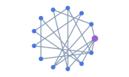 | 圆周或螺旋排列 | radius、startRadius、endRadius、startAngle、endAngle、clockwise |
| [`concentric`](/docs/guides/layout-concentric) | 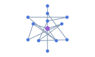 | 按重要程度分圈 | sortBy、maxLevelDiff、nodeSize、nodeSpacing、preventOverlap |
| [`grid`](/docs/guides/layout-grid) | 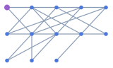 | 规则行列 | rows、cols、begin、sortBy、nodeSize、nodeSpacing、preventOverlap |
| [`random`](/docs/guides/layout-random) | 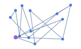 | **可选。** 随机位置 | width、height、center |
| [`dagre`](/docs/guides/layout-dagre) | 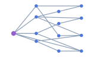 | 有向分层 | rankdir: TB/BT/LR/RL，nodesep、ranksep、edgesep、nodeSize、ranker |
| [`force`](/docs/guides/layout-force) | 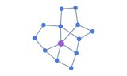 | 力导向网络 | linkDistance、nodeStrength、edgeStrength、maxIteration、minMovement |
| [`d3-force`](/docs/guides/layout-d3-force) | 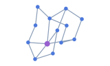 | D3 力模拟 | linkDistance、nodeStrength、alphaDecay、alphaMin；使用 nodeStrength，不是 charge |
| [`force-atlas2`](/docs/guides/layout-force-atlas2) | 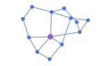 | ForceAtlas2 网络 | kr、kg、barnesHut、prune、maxIteration |
| [`fruchterman`](/docs/guides/layout-fruchterman) | 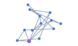 | Fruchterman 网络 | gravity、speed、maxIteration、minMovement |
| [`radial`](/docs/guides/layout-radial) | 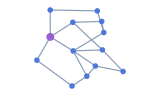 | **可选。** 围绕焦点的同心层 | focusNode、unitRadius、linkDistance、preventOverlap |
| [`mds`](/docs/guides/layout-mds) | 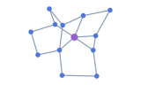 | **可选。** 按图距离求二维位置 | linkDistance、center |

</div>

节点间距取决于布局计算使用的尺寸。需要避免重叠时，把节点实际尺寸传给算法支持的 `nodeSize` 等参数，再调整 `nodeSpacing`。

### 计算默认值 [#计算默认值]

以下由 G6Lite 注入或改写，用户显式值优先；仅适用于上面的库布局，不用于三个函数式树布局。

| 算法 / 选项 | 默认或规则 |
| --- | --- |
| 全部库布局 `animate` | 省略时 false；Graph 在计算完成后写回坐标，不提供逐帧布局绘制 |
| `iterations` | 若有此字段且无 maxIteration，映射到 maxIteration；随后删除 iterations。不要把它当作所有算法通用的迭代开关 |
| force / fruchterman，节点数 < 1000 | maxIteration: 100，minMovement: 1 |
| force / fruchterman，1000–5000 个节点 | maxIteration: 200，minMovement: 1.5 |
| force / fruchterman，节点数 > 5000 | maxIteration: 50，minMovement: 2 |
| force-atlas2 | barnesHut: true；节点数 > 200 时默认 prune: false；maxIteration 默认 100，节点数 > 5000 时 50 |
| d3-force | alphaDecay: 0.1；linkDistance: max(200, √节点数 × 80) |

主线程 d3-force 由封装手动 tick，最多 300 次，并检查 alphaMin（默认 0.001）；Worker 路径等待算法结束，两条执行路径不保证逐点相同。算法内部其他默认值以安装版本为准，不与 G6Lite 的注入值混用。

<span id="效果预览" />

## 切换布局示例 [#options-layout-代码与对应效果]

用 **Layout** 切换网格、环形和 Dagre 布局。下方代码列出了三种布局的参数。

<LayoutDocExample id="layout-switch" locale="zh" focus="layout-options" />

## 树布局示例 [#示例]

树的父子关系写在 `edges` 里，`source` 是父节点，`target` 是子节点。可在[树布局示例](/docs/guides/layout-trees#配置与示例)里切换脑图、缩进树和鱼骨图。

### 树布局类型 [#函数式树布局]

树布局适合只有一个根、节点彼此连通且没有环的数据。

<div className="effect-table">

| type | 效果 | 用途 |
| --- | --- | --- |
| [`mindmap`](/docs/guides/layout-mindmap) | 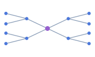 | **可选。** 按左右分支组织层级 |
| [`indented`](/docs/guides/layout-indented) | 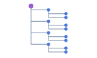 | **可选。** 逐行展示树形列表 |
| [`fishbone`](/docs/guides/layout-fishbone) | 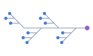 | **可选。** 沿主干展示分类和条目 |

</div>

#### mindmap [#mindmap]

| 选项 | 类型 | 默认 / 行为 |
| --- | --- | --- |
| `direction` | `'H' \| 'LR' \| 'RL'` | H；LR 全右、RL 全左；H 通过 getSide 决定左右，默认也返回 right |
| `levelGap` | `number` | 120，父子节点边界间的水平距离 |
| `nodeGap` | `number` | 30，同侧相邻子节点间距 |
| `branchColors` | `string[]` | 内置 10 色；结果写入节点 data._branchColor，需样式函数读取才会着色 |
| `getWidth` | `(node: GraphNode) => number` | 返回 100 |
| `getHeight` | `(node: GraphNode) => number` | 返回 40 |
| `getSide` | `(node: GraphNode, index: number, parentSide?: 'left' \| 'right') => 'left' \| 'right'` | 返回 right；node 仅包含 id 和 data |

根取输入中第一个无父节点；没有时取第一个节点，根坐标 (0, 0)。不支持旧写法 hGap/vGap，使用 levelGap/nodeGap。

#### indented [#indented]

| 选项 | 类型 | 默认 / 行为 |
| --- | --- | --- |
| `indent` | `number` | 80，每深入一层的水平偏移 |
| `rowHeight` | `number` | 40，DFS 顺序下相邻行的距离 |
| `direction` | `'LR' \| 'RL'` | LR；RL 使用负的水平坐标 |
| `rootId` | `string` | 优先指定根，否则取第一个无父节点，再回退第一个节点 |
| `nodeColors` | `string[]` | 省略不写色值；传非空色板后按深度写 data._nodeColor |
| `edgeColors` | `string[]` | 省略不写色值；传非空色板后按深度写节点 data._edgeColor，边样式需从节点读取 |

遍历到的节点还会得到 data.depth 与 data._isRoot；根坐标 (0, 0)。这些是布局产生的数据，不会自动改变节点或边样式。

#### fishbone [#fishbone]

用于根 → 分类 → 条目的三层结构，更深节点没有完整的位置分配。

| 选项 | 类型 | 默认 / 行为 |
| --- | --- | --- |
| `direction` | `'LR' \| 'RL'` | LR；RL 镜像水平位置 |
| `categoryGap` | `number` | 180，分类在主干上的间距 |
| `categoryDistance` | `number` | 200，分类与主干的偏移尺度 |
| `itemHStep` | `number` | 20，条目的额外水平偏移 |
| `getWidth` | `(node: GraphNode) => number` | 返回 80，参与根和条目的定位 |
| `getHeight` | `(node: GraphNode) => number` | 返回 30；当前会被调用，但保存的高度不参与坐标计算 |
| `itemGap` | `number` | 当前只有类型声明，运行时不读取，不应依赖其调整间距 |

<span id="坐标与运行时" />

## 运行时重新布局

首次渲染后，布局配置通过 `setLayout()` 替换，节点位置在 `layout()` 完成后更新。需要让整张图重新进入视野时，再调用 `fitView()`。

```ts
graph.setLayout({ type: 'dagre', rankdir: 'LR', nodesep: 32, ranksep: 64 });
await graph.layout();
graph.fitView({ padding: 48, maxZoom: 1 });
```

需要保留当前视野时，省略最后一行。用 `setData()` 替换整批数据时会重新布局。逐项更新节点后，可以按需调用 `layout()`。

已有 x/y 在布局执行后可能改变。Graph 的 fx/fy 可固定最终写回的对应轴，但不保证计算过程把它们作为算法约束。

## Worker

库布局可通过 `worker: true` 尝试在后台线程计算。图达到 1000 个节点时默认尝试启用。算法参数包含函数时，可设置 `worker: false` 在主线程计算。启用、回退和取消示例见 [Worker 布局指南](/docs/guides/layout-worker)。

## 常见问题

### 改了配置，为什么节点没有移动？

setLayout 只存配置，之后需 await graph.layout()；updateOptions 不更新布局。layout 需在首次 render 完成后调用。

### 重新布局后图跑到画布外了？

layout 不自动适配相机。需要展示全图时，在完成后显式调用 fitView；图坐标 center 不能代替相机适配。

### 树节点为什么堆在原点，或间距参数无效？

先检查根、边方向和连通性。mindmap 使用 levelGap/nodeGap；hGap/vGap 不生效，fishbone 的 itemGap 当前也不生效。

## 相关

- [布局配置参考](/docs/api/options#options-layout)：字段、默认值与算法边界。
- [Graph 布局方法](/docs/api/graph#graph-layout)：重排与取消。
- [布局总览](/docs/guides/layout-overview) · [性能调优](/docs/metrics/performance#performance-tuning)。

**相关可运行示例**

- [常用布局切换](/docs/examples/layouts)
- [更多布局示例](/docs/examples/layout-gallery)
- [流程图](/docs/examples/flowchart)
- [缩进树](/docs/examples/indented-tree)
- [辐射树](/docs/examples/radial-tree)
- [调用链](/docs/examples/dependency-graph)
- [组织架构图](/docs/examples/org-chart)
- [思维导图](/docs/examples/mindmap)
- [鱼骨图](/docs/examples/fishbone)
